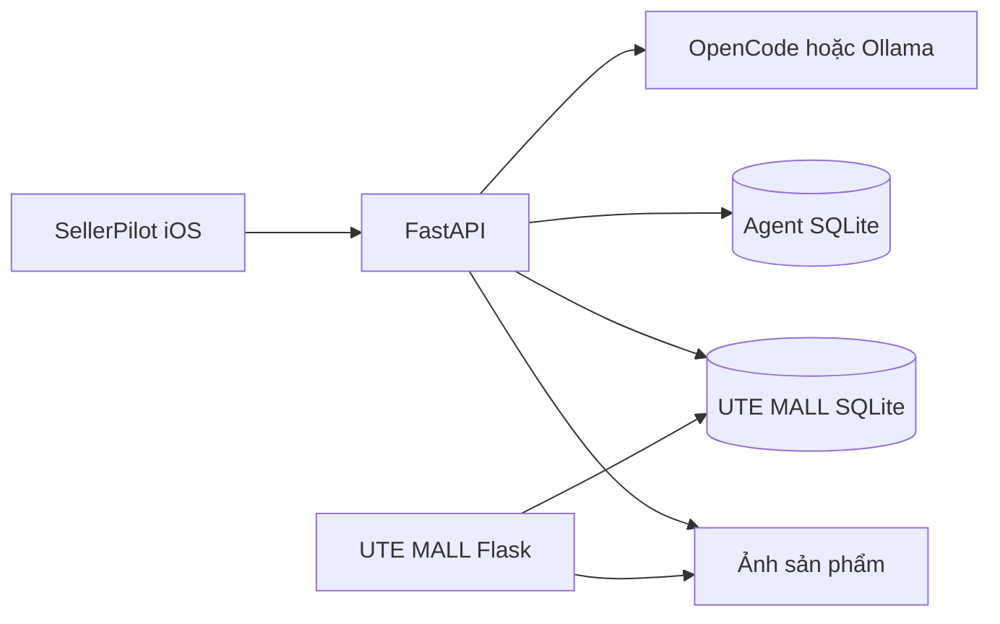

# ShipCode SellerPilot

Trợ lý AI dành cho **chủ shop**, kết hợp ứng dụng quản lý trên iOS và sàn thương mại điện tử UTE MALL. Chủ shop có thể xem số liệu, trao đổi về kinh doanh, tính giá bán và soạn sản phẩm từ ảnh; các thay đổi quan trọng có bước xác nhận.

SellerPilot kết nối với gian hàng **UTech Official** trong UTE MALL. Đây là hệ thống demo local, chưa tích hợp Shopee, TikTok Shop, thanh toán hoặc vận chuyển thực tế.

## Sản phẩm

| Thành phần | Công nghệ | Vai trò |
| --- | --- | --- |
| SellerPilot | Expo, React Native, TypeScript | Quản lý, sản phẩm, chat AI, đơn hàng và thông tin shop |
| SellerPilot API | FastAPI, SQLAlchemy, Alembic, SQLite | Đọc dữ liệu shop, kiểm tra tham số, quản lý tác vụ và xác nhận thay đổi |
| UTE MALL | Flask, Flask-SQLAlchemy, Jinja | Marketplace nhiều ngành hàng, người mua và Kênh Người Bán |
| AI | OpenCode hoặc Ollama | Hiểu yêu cầu, phân tích dữ liệu và soạn nội dung |

### Những gì đã hoạt động

- Tổng quan hôm nay/7/30 ngày, biểu đồ giá trị đơn hàng, trạng thái đơn và việc cần xử lý.
- Danh mục có ảnh, tìm theo tên/SKU, hàng sắp hết và chi tiết đơn hàng.
- Chat có lịch sử, bộ nhớ theo shop/SKU và tư vấn dựa trên dữ liệu backend cung cấp.
- Tính hòa vốn, lợi nhuận, biên lời, giá mục tiêu và tác động của giảm giá từ chi phí chủ shop cung cấp.
- Đổi giá bằng đề xuất → xác nhận → cập nhật shop → nhật ký.
- Chọn tối đa 6 ảnh, AI soạn tên/mô tả, hỏi lại thông tin thiếu, duyệt bản nháp rồi đăng lên gian hàng.
- Mã yêu cầu chống xử lý trùng; Dừng hủy tác vụ trên backend; khôi phục kết quả sau mất kết nối.
- Website mua–bán dùng chung danh mục, giỏ hàng, đơn hàng, voucher, đánh giá và hộp thư.

Các kỳ tổng quan đã xem được giữ trong bộ nhớ tối đa 60 giây để chuyển lại nhanh. Sau thời hạn hoặc khi đổi ngày theo giờ Việt Nam, app lấy dữ liệu mới. Kéo làm mới, nút Đồng bộ và thay đổi shop qua AI sẽ xóa cache các kỳ; số liệu của kỳ cũ không được hiển thị dưới kỳ vừa chọn khi đang tải.

## Yêu cầu môi trường

- **Node.js 22.13 trở lên**, npm đi kèm Node.
- **Python 3.11**; nên dùng bản từ python.org hoặc Homebrew thay Python hệ thống macOS.
- Git.
- iPhone cài Expo Go tương thích Expo SDK 57; hoặc Xcode + iOS Simulator trên macOS. Android và web cũng dùng được để phát triển.
- OpenCode nếu dùng Muse; hoặc Ollama nếu dùng Qwen. Không cần cài cả hai.

Cài công cụ từ nguồn chính thức: [Node.js](https://nodejs.org/), [Python](https://www.python.org/downloads/), [Expo Go](https://expo.dev/go), [OpenCode](https://opencode.ai/docs/), [Ollama](https://ollama.com/download).

> Backend API và UTE MALL dùng **hai virtualenv riêng**. Không dùng lẫn vì phiên bản dependency khác nhau. Mỗi lệnh bên dưới ghi rõ thư mục chạy.

## 1. Clone và cài frontend

Từ terminal:

```sh
git clone https://github.com/nguyenkhang310/shipcode-sellerpilot.git
cd shipcode-sellerpilot
npm ci
```

Giữ terminal ở thư mục gốc repository khi chạy các lệnh `npm run ...` trong hướng dẫn này. Không chạy `npx expo start` từ thư mục home của máy.

## 2. Cài và khởi tạo UTE MALL

### macOS / Linux

Từ thư mục gốc:

```sh
python3.11 -m venv "UTE MALL/.venv"
"UTE MALL/.venv/bin/python" -m pip install -r "UTE MALL/requirements.txt"
"UTE MALL/.venv/bin/python" "UTE MALL/bootstrap_demo.py"
```

### Windows PowerShell

Từ thư mục gốc:

```powershell
py -3.11 -m venv "UTE MALL/.venv"
& ".\UTE MALL\.venv\Scripts\python.exe" -m pip install -r "UTE MALL\requirements.txt"
& ".\UTE MALL\.venv\Scripts\python.exe" "UTE MALL\bootstrap_demo.py"
```

Lần đầu, chương trình yêu cầu **tự đặt mật khẩu cho tài khoản `utech`**. Mật khẩu không hiện khi nhập. Không có mật khẩu chủ shop dùng chung trong source hoặc README.

Bootstrap tạo khóa session riêng trong `UTE MALL/.env`, nạp catalog công khai được đóng gói và sinh dữ liệu vận hành mô phỏng: 24 shop, 16 ngành, 5.843 sản phẩm nguồn, 1.500 đơn và 450 người mua giả lập. Catalog không chứa tài khoản, đơn hàng, lịch sử chat hoặc ảnh tải lên của máy phát triển. [Nguồn và giấy phép dữ liệu](THIRD_PARTY_NOTICES.md).

**Không chạy lại bootstrap trên shop đang dùng.** Chương trình từ chối ghi đè database đã có sản phẩm. Kiểm tra mà không khởi tạo lại:

```sh
"UTE MALL/.venv/bin/python" "UTE MALL/bootstrap_demo.py" --check
```

Muốn tạo một bộ demo riêng, cấu hình `STORE_DATABASE_PATH` trỏ tới file mới trước khi chạy bootstrap. Người tự động hóa có thể cung cấp `DEMO_SELLER_PASSWORD` qua môi trường riêng; không đưa mật khẩu vào lệnh, commit hoặc log.

## 3. Cài SellerPilot API

### macOS / Linux

Từ thư mục gốc:

```sh
python3.11 -m venv backend/.venv
backend/.venv/bin/python -m pip install -r backend/requirements-dev.lock
backend/.venv/bin/python -m pip install --no-deps -e './backend[dev]'
cp .env.example .env
```

### Windows PowerShell

```powershell
py -3.11 -m venv backend/.venv
& ".\backend\.venv\Scripts\python.exe" -m pip install -r backend/requirements-dev.lock
& ".\backend\.venv\Scripts\python.exe" -m pip install --no-deps -e './backend[dev]'
Copy-Item .env.example .env
```

Nếu đã có `.env`, giữ cấu hình hiện tại và đối chiếu `.env.example`; không copy ghi đè. Backend đọc `.env` ở root rồi `backend/.env` nếu có; biến môi trường shell được ưu tiên.

### Chọn AI provider

**OpenCode / Muse** — `.env` ở thư mục gốc:

```dotenv
AI_PROVIDER=opencode
OPENCODE_MODEL=muse-spark-1.3-contributor-free
OPENCODE_GENERATION_TIMEOUT_SECONDS=90
```

Kiểm tra `opencode --version` chạy được trên terminal trước khi mở API. Backend tự tạo một OpenCode server riêng trên localhost, dùng session riêng cho mỗi lượt gọi và dọn session khi xong hoặc hủy. Không cần mở giao diện chat OpenCode song song. Muse được gọi qua provider của OpenCode và cần Internet; không chạy offline như Qwen.

Code chỉ chấp nhận model Free đã cấu hình và kiểm tra metadata chi phí; không tự chuyển sang model tính phí. Model hoặc hạn mức miễn phí có thể không còn sẵn trên bản OpenCode của thành viên. Khi đó chat báo chế độ dự phòng; các truy vấn trực tiếp được hỗ trợ vẫn đọc dữ liệu shop. Đây không phải cam kết dịch vụ miễn phí lâu dài.

**Ollama / Qwen** — lựa chọn local:

```sh
ollama pull qwen3:4b-instruct
```

```dotenv
AI_PROVIDER=ollama
OLLAMA_HOST=http://127.0.0.1:11434
OLLAMA_MODEL=qwen3:4b-instruct
```

Ollama phải đang chạy. Model Qwen hiện cấu hình là model văn bản: không thay thế khả năng nhận ảnh của Muse. Lần đầu đọc model từ HDD có thể chậm.

## 4. Chạy ba tiến trình

### Terminal A — UTE MALL

macOS/Linux, từ root:

```sh
cd "UTE MALL"
HOST=0.0.0.0 ./run_store.sh
```

PowerShell, từ root:

```powershell
cd "UTE MALL"
$env:HOST="0.0.0.0"
& ".\.venv\Scripts\python.exe" app.py
```

- Trang mua sắm: <http://127.0.0.1:5011>
- UTech Official: <http://127.0.0.1:5011/shop/utech-official>
- Kênh Người Bán: <http://127.0.0.1:5011/seller>

Đăng nhập bằng `utech` và mật khẩu đã đặt khi bootstrap. Tài khoản tự đăng ký trên web là **người mua**, không tự nhận quyền quản lý gian hàng.

### Terminal B — SellerPilot API

macOS/Linux, từ root:

```sh
cd backend
HOST=0.0.0.0 ./run_api.sh
```

Script chạy Alembic trước khi mở API, nạp nóng Qwen nếu dùng Ollama và chạy một Uvicorn worker.

PowerShell, từ root:

```powershell
cd backend
& ".\.venv\Scripts\alembic.exe" upgrade head
& ".\.venv\Scripts\python.exe" -m uvicorn app.main:app --host 0.0.0.0 --port 8000 --workers 1
```

- Swagger: <http://127.0.0.1:8000/docs>
- Health: <http://127.0.0.1:8000/api/v1/health>

`status=degraded` có thể nghĩa là AI chưa sẵn sàng dù database hoạt động. Xem `database`, `shop_database`, `ai_availability`, `model_available` trong phản hồi health.

### Terminal C — ứng dụng

Từ thư mục gốc:

```sh
npm run start --workspace frontend -- --clear
```

Quét QR bằng Expo Go, hoặc nhấn `i` để mở iOS Simulator nếu đã cài Xcode. Xem bản web tại <http://localhost:5173> bằng terminal riêng với `npm run web`.

**iPhone thật:** điện thoại và máy chạy API phải cùng Wi-Fi. Không dùng `127.0.0.1` trên điện thoại để trỏ về máy tính. Khi không khai báo `EXPO_PUBLIC_API_URL`, bản phát triển Expo Go tự lấy IP LAN của Metro. Nếu cần chỉ định hoặc dùng tunnel, tạo `frontend/.env`:

```dotenv
EXPO_PUBLIC_API_URL=http://IP_LAN_CUA_MAY:8000/api/v1
EXPO_PUBLIC_STORE_URL=http://IP_LAN_CUA_MAY:5011
```

Thay `IP_LAN_CUA_MAY` bằng IP thật. Restart Expo sau khi thay `.env`. Các biến `EXPO_PUBLIC_*` được đóng gói vào app, không được chứa secret. Expo tunnel chỉ chuyển tiếp Metro, không tự mở cổng 8000/5011. `0.0.0.0` là địa chỉ bind server, không phải URL để nhập trong app.

## Kiểm tra trước khi làm demo / gửi thay đổi

Từ thư mục gốc:

```sh
npm run typecheck
npm run test:api
npm run build
npm run build:ios
```

Từ `backend/`:

```sh
.venv/bin/python -m pytest
.venv/bin/alembic upgrade head
```

Kiểm tra UTE MALL từ root:

```sh
"UTE MALL/.venv/bin/python" "UTE MALL/tests/bootstrap_test.py"
"UTE MALL/.venv/bin/python" -W ignore "UTE MALL/tests/commerce_test.py"
```

Commerce test tạo bản sao SQLite tạm và thay thông tin đăng nhập **chỉ trong bản sao**. Backend tests cũng dùng database tạm; không gọi model bên ngoài. CI chạy kiểm tra TypeScript, API transport, export web/iOS, backend và tạo demo UTE MALL mới để kiểm tra quy trình mua–bán.

`build:ios` xuất JS/Hermes bundle, **không tạo IPA**. EAS config nằm trong `frontend/eas.json`; cloud build chưa nằm trong quy trình local này.

Hướng dẫn kiểm thử giao diện, bàn phím mô phỏng, mất mạng và khôi phục: [frontend/tests/README.md](frontend/tests/README.md). Cần kiểm thử thêm bàn phím và việc chuyển app trên iPhone thật trước buổi trình diễn.

## Kiến trúc và quy tắc dữ liệu



- Model nhận lịch sử và dữ liệu có cấu trúc từ backend; không được tự chạy shell, SQL hay đọc file của dự án.
- Dữ liệu shop nằm tại `UTE MALL/instance/ecommerce.db`. Agent metadata nằm tại `backend/data/sellerpilot.db`.
- Ảnh chat nằm tại `UTE MALL/static/uploads/sellerpilot/`; file ảnh không nhét trong SQLite.
- Doanh số/tồn kho là dữ liệu shop; chi phí và giả định tính lời phải được người bán cung cấp. Không đồng nhất giá trị đơn với tiền thực thu.
- Chạy **một worker API**. Hàng đợi local và khóa trong bộ nhớ chưa dành cho nhiều process/server dùng chung DB.
- Không có transaction atomic xuyên hai SQLite và filesystem. Khi crash trong lúc ghi shop, cần đối chiếu bản nháp/nhật ký trước khi gửi lệnh mới.
- App hiện gắn một shop local; xác thực/phân quyền API cho nhiều chủ shop và triển khai Internet là bước riêng.

[Luồng chat và chống trùng](docs/CHAT_RELIABILITY.md) · [Tư vấn và bộ nhớ](docs/PERSONAL_ADVISOR.md).

## Cấu trúc source

```text
frontend/src/
  api/                         HTTP client, contracts, request recovery
  app/                         AppShell, điều hướng và bàn phím
  components/                  Header, thanh tab, logo, ảnh sản phẩm
  features/assistant/          Chat, lịch sử, media, proposal và bản nháp
  features/dashboard/          Quản lý, biểu đồ, sản phẩm và đơn hàng
  theme/                       Design tokens và styles đang dùng
backend/
  app/ai/                      Provider adapters, schemas và prompts
  app/api/v1/endpoints/         API routes
  app/integrations/ute_mall.py  Gateway tới database gian hàng
  app/services/                Điều phối chat, tác vụ, bộ nhớ, tính giá, đăng hàng
  app/models/                  Agent runs, proposal, audit, draft, memory, requests
  alembic/                     Migration database agent
  tests/                       Kiểm tra hành vi, lỗi và đồng thời
UTE MALL/
  app.py, seller.py             Website người mua và Kênh Người Bán
  models.py, commerce.py        Schema và quy tắc giao dịch
  bootstrap_demo.py            Khởi tạo máy mới, không ghi đè dữ liệu
  data/demo-catalog.json.gz     Catalog công khai đã chọn, không phải database
  static/catalog/              Ảnh dataset có attribution
  tests/                       Kiểm thử mua–bán trên database tạm
sample_data/                   Bộ ca kiểm thử ý định
```

`App.tsx` ở root chỉ re-export entry frontend để tương thích cấu hình IDE. Kế hoạch ban đầu và tài liệu cuộc thi được giữ riêng; README này là hướng dẫn vận hành hiện tại.

## Xử lý sự cố

| Hiện tượng | Kiểm tra |
| --- | --- |
| `package.json does not exist` | Terminal đang ở sai thư mục. `cd shipcode-sellerpilot` trước khi chạy npm. |
| iPhone không kết nối | Cùng Wi-Fi, IP LAN đúng, API bind `0.0.0.0`, firewall cho phép cổng 8000/5011; restart Expo sau sửa `.env`. |
| Chat phản hồi dự phòng | Kiểm tra health và `opencode --version` hoặc Ollama/model. Đọc `fallback_reason` trong Swagger. |
| `no such table: chat_request` | Từ `backend/`, chạy `.venv/bin/alembic upgrade head`, rồi restart API. |
| Shop database không tồn tại | Chạy bootstrap UTE MALL trước API; không sửa tên thư mục bằng tay. |
| Chọn ảnh nhưng chưa gửi | Đây là bản đính kèm. Nhập yêu cầu rồi bấm nút gửi; chọn ảnh không tự đăng hàng. |
| Không nhớ mật khẩu `utech` | Hỏi người đã bootstrap máy đó; không có mật khẩu chung trong GitHub. Giữ nguyên DB, không seed đè để đổi mật khẩu. |
| Cổng đang được sử dụng | Dừng tiến trình cũ bằng Ctrl+C ở terminal tương ứng. Không mở nhiều API chung agent DB. |
| Ô chat không đổi sau cập nhật | Restart Expo với `--clear`, mở lại project đúng QR và kiểm tra đang chạy source mới. |

Dừng ba tiến trình bằng Ctrl+C ở từng terminal. API tự dọn OpenCode server do nó tạo; không dừng phiên OpenCode riêng của thành viên.

## Đóng góp

Tạo branch theo thay đổi, cập nhật test/hướng dẫn liên quan và chạy các kiểm tra trước khi mở pull request. Không commit `.env`, virtualenv, `node_modules`, database, mailbox, model, backup, ảnh upload hoặc kết quả hội thoại cá nhân. Không sửa trực tiếp dữ liệu nguồn để làm test pass. Kết quả UI test tự sinh trong `docs/evaluations/` và không thuộc source phát hành.
