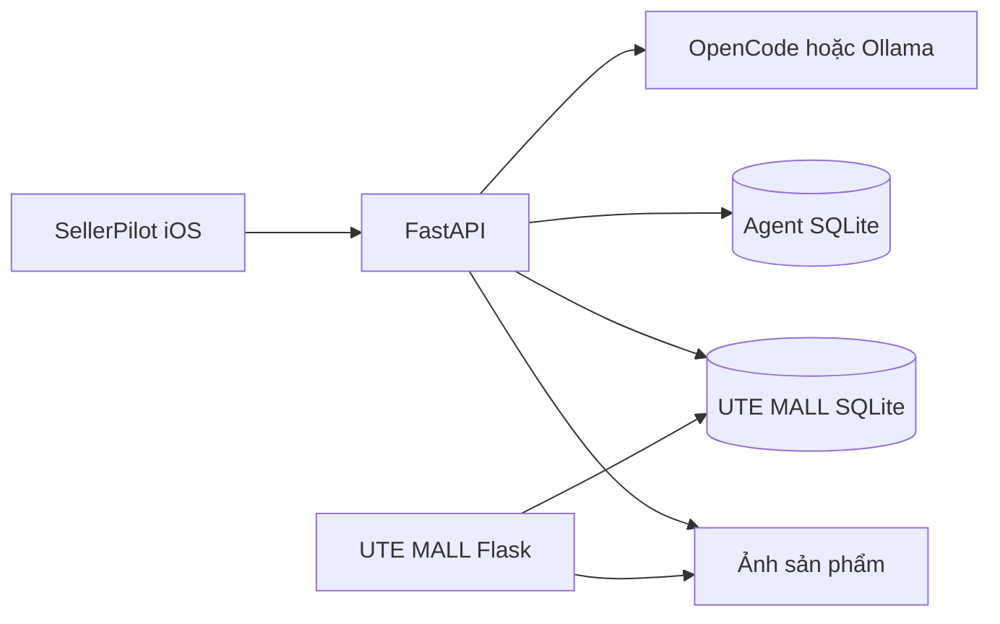

# ShipCode SellerPilot

Trợ lý AI dành cho **chủ shop**, kết hợp ứng dụng quản lý trên iOS và website mô phỏng Shopee. Chủ shop có thể xem số liệu, trao đổi về kinh doanh, tính giá bán và soạn sản phẩm từ ảnh; các thay đổi quan trọng có bước xác nhận.

SellerPilot kết nối với gian hàng **UTech Official** trong bản Shopee Demo. Đây là hệ thống local của nhóm, không phải website Shopee chính thức và chưa kết nối API Shopee/TikTok Shop, thanh toán hoặc vận chuyển thực tế. Thư mục source vẫn là `UTE MALL/` để giữ ổn định đường dẫn database và các lệnh chạy đã có.

Đã bổ sung [luồng Chrome Extension](extensions/shopee-connector/README.md) dùng
chung các thành phần chat/ảnh, có bố cục desktop riêng, chọn mục tiêu bằng nhãn tài
khoản trên trang Shopee đã đăng nhập và hỗ trợ điền form. Không gửi nguyên văn
trang hay lấy số liệu local thay cho dữ liệu Shopee. Nhãn được chọn chưa phải
Shop ID xác thực qua API; có luồng tự đọc danh sách qua các trang trong một tab nền
dùng chung, cache riêng theo shop và tổng hợp tồn kho cho AI. Gửi chat không tự mở
tab hoặc thử lại đồng bộ lỗi; đồng bộ chạy lúc liên kết mới hoặc bấm Cập nhật.
Bộ đọc còn phụ thuộc bố cục/phân trang Shopee, chưa đạt đủ
nghiệp vụ app hoặc xác minh lưu/đăng trên Shopee thật.

## Sản phẩm

| Thành phần | Công nghệ | Vai trò |
| --- | --- | --- |
| SellerPilot | Expo, React Native, TypeScript | Quản lý, sản phẩm, chat AI, đơn hàng và thông tin shop |
| SellerPilot API | FastAPI, SQLAlchemy, Alembic, SQLite | Đọc dữ liệu shop, kiểm tra tham số, quản lý tác vụ và xác nhận thay đổi |
| Shopee Demo (`UTE MALL/`) | Flask, Flask-SQLAlchemy, Jinja | Marketplace nhiều ngành hàng, người mua và Kênh Người Bán |
| AI | Gemini API; Groq dự phòng tùy chọn; CLI/Ollama tùy chọn | Hiểu yêu cầu, phân tích dữ liệu và soạn nội dung |

### Những gì đã hoạt động

- Tổng quan hôm nay/7/30 ngày hoặc từng ngày lịch sử: chọn lịch, chuyển ngày trước/sau, biểu đồ theo giờ và so sánh với ngày trước theo giờ Việt Nam. Bộ chọn kỳ có hiệu ứng trượt, hỗ trợ Giảm chuyển động.
- Danh mục có ảnh, tìm theo tên/SKU, hàng sắp hết và chi tiết đơn hàng.
- Xử lý đơn ngay trên app: sửa thông tin nhận hàng trước khi bàn giao, ghi chú, xác nhận/bàn giao/đã giao/hủy theo trạng thái hợp lệ. Xem lại trước khi lưu; chống ghi đè và hoàn kho trùng. [Phạm vi và cách dùng](docs/ORDER_MANAGEMENT.md).
- Theo dõi đơn ngay trên từng thẻ: tiến trình, lịch sử cập nhật, đơn vị vận chuyển/mã vận đơn và cập nhật nền. Không mở trang mua hàng; trạng thái và mã vận đơn do shop local ghi nhận, chưa tra cứu hãng vận chuyển thật.
- App, Kênh Người Bán và trang đơn của người mua dùng chung nhật ký/vận đơn; chọn hãng, lưu mã và sao chép ngay trong app. Chat tra trạng thái mới nhất theo mã đơn, hiểu câu hỏi tiếp và mở form xử lý trực tiếp.
- Chat tra toàn bộ danh mục shop theo nhiều từ khóa và khoảng giá đã nêu,
  ví dụ `Shop có chuột máy tính dưới 1tr không?`; đếm kết quả trước khi phân trang,
  không suy loại hàng shop có từ vài sản phẩm mẫu. Áp dụng cho database shop local;
  extension Shopee thật vẫn theo phạm vi dữ liệu trình duyệt đã đọc được.
- Chat có lịch sử, vuốt trái để ghim/bỏ ghim hoặc xóa hội thoại, bộ nhớ theo shop/SKU và tư vấn dựa trên dữ liệu backend cung cấp.
- Tính hòa vốn, lợi nhuận, biên lời, giá mục tiêu và tác động của giảm giá từ chi phí chủ shop cung cấp.
- Kế hoạch kinh doanh theo số liệu trong kỳ, lịch hành động, kịch bản video có cảnh/thoại/caption và hướng dẫn đo hiệu quả. [Cách dùng và giới hạn](docs/BUSINESS_ADVISOR.md).
- Đổi giá bằng đề xuất → xác nhận → cập nhật shop → nhật ký.
- Sửa tên/mô tả/giá/tồn thủ công ngay trong tab Sản phẩm hoặc đề xuất qua chat. Chọn SKU phân loại, xem trước thay đổi, xác nhận; chống ghi đè và xử lý trùng khi mất phản hồi. [Hướng dẫn sửa sản phẩm](docs/PRODUCT_EDITS.md).
- Tạo bản nháp từ tin nhắn hoặc tối đa 6 ảnh; AI soạn tên/mô tả, hiểu câu ngắn theo ngữ cảnh và hỏi phần thiếu. Có thể bổ sung ảnh sau, giữ giá/tồn đã cung cấp; duyệt bản nháp rồi đăng lên gian hàng local.
- Gửi ảnh kèm đoạn mô tả tự nhiên trong một lượt: AI nhận tên, giá, tồn và ngành hàng cùng lúc; giữ caption đã viết, phân biệt giá vốn/giá bán, nhận chỉnh sửa nhiều trường và chỉ hỏi phần còn thiếu. Tin nhắn hỗ trợ tối đa 4.000 ký tự.
- Mã yêu cầu chống xử lý trùng; Dừng hủy tác vụ trên backend; khôi phục kết quả sau mất kết nối.
- Ngữ cảnh giữ đủ tin nhắn dài trong ngân sách prompt; câu hỏi nối tiếp giữ kỳ thống kê đang bàn. Kế hoạch cho tương lai được tách khỏi số liệu đã ghi nhận.
- Website mua–bán dùng chung danh mục, giỏ hàng, đơn hàng, voucher, đánh giá và hộp thư.
- Logo Shopee vector, favicon local và nhận diện đồng bộ trên các trang mua/bán. Mỗi sản phẩm đang bán có 16–32 đánh giá mô phỏng bổ sung theo ngành hàng, phân trang/lọc sao và phản hồi shop. Không tạo đơn hàng hay thay đổi doanh thu/tồn kho khi tạo các bình luận này.

Các kỳ tổng quan đã xem được giữ trong bộ nhớ tối đa 60 giây để chuyển lại nhanh. Sau thời hạn hoặc khi đổi ngày theo giờ Việt Nam, app lấy dữ liệu mới. Kéo làm mới, nút Đồng bộ và thay đổi shop qua AI sẽ xóa cache các kỳ; số liệu của kỳ cũ không được hiển thị dưới kỳ vừa chọn khi đang tải.

Trong **Quản lý**, bấm biểu tượng lịch bên cạnh Hôm nay/7 ngày/30 ngày để chọn
một ngày từ năm 1970 đến hiện tại. Mũi tên chuyển từng ngày; Hôm nay trở về số
liệu đang cập nhật. Ngày lịch sử lấy đủ 00:00–24:00 theo giờ Việt Nam, hôm nay
chỉ lấy đến hiện tại; biểu đồ một ngày chia theo giờ. Việc cần làm và sản phẩm
bán chạy lũy kế vẫn là thông tin toàn shop, không phải lịch sử tồn kho của ngày đó.

Khi đang xem **Quản lý**, app kiểm tra số liệu mới mỗi 5 giây và cập nhật tại chỗ. Việc kiểm tra tạm dừng khi app chạy nền hoặc chuyển tab; quay về Quản lý sẽ lấy lại dữ liệu. Mất kết nối giữ số liệu đã lấy gần nhất và báo chưa đồng bộ.

Ví dụ, chọn ảnh rồi nhắn: `Mình bán bàn phím Nova K75 màu trắng, giá vốn 500k, bán 990k, kho còn 20 cái. Đăng giúp mình.` AI chuẩn bị bản nháp để duyệt. Nhắn tiếp `Để 850 nghìn thôi, còn 12 chiếc nhé` sẽ sửa bản nháp hiện tại. Sản phẩm chỉ được đăng sau khi chủ shop xác nhận; giá/tồn không được tự đoán từ ảnh.

## Yêu cầu môi trường

- **Node.js 22.13 trở lên**, npm đi kèm Node.
- **Python 3.11**; nên dùng bản từ python.org hoặc Homebrew thay Python hệ thống macOS.
- Git.
- iPhone cài Expo Go tương thích Expo SDK 57; hoặc Xcode + iOS Simulator trên macOS. Android và web cũng dùng được để phát triển.
- Gemini API key cho cấu hình mặc định; CLI/OpenCode/Ollama chỉ cần khi chọn provider tương ứng.

Cài công cụ từ nguồn chính thức: [Node.js](https://nodejs.org/), [Python](https://www.python.org/downloads/), [Expo Go](https://expo.dev/go), [Antigravity CLI](https://www.antigravity.google/docs/cli/install/), [OpenCode](https://opencode.ai/docs/), [Ollama](https://ollama.com/download).

> Backend API và UTE MALL dùng **hai virtualenv riêng**. Không dùng lẫn vì phiên bản dependency khác nhau. Mỗi lệnh bên dưới ghi rõ thư mục chạy.

### Chuẩn bị trên Ubuntu

Các bước dưới đây áp dụng cho Ubuntu Desktop/Server. Cài công cụ hệ thống:

```sh
sudo apt update
sudo apt install -y build-essential curl git
```

Cài Node.js 22.13 trở lên từ [nodejs.org](https://nodejs.org/) và kiểm tra:

```sh
node --version
npm --version
git --version
```

Các lệnh tạo virtualenv phía dưới cần Python 3.11. Nếu Ubuntu chưa có `python3.11`, có thể dùng `uv` để cài riêng phiên bản này mà không thay Python hệ thống:

```sh
curl -LsSf https://astral.sh/uv/install.sh | sh
uv python install 3.11
```

Sau khi cài `uv`, mở terminal mới. Ở bước tạo virtualenv cho UTE MALL và backend bên dưới, dùng `uv venv --seed --python 3.11 <đường-dẫn-venv>` thay cho `python3.11 -m venv <đường-dẫn-venv>`. Ví dụ:

```sh
uv venv --seed --python 3.11 "UTE MALL/.venv"
uv venv --seed --python 3.11 backend/.venv
```

`--seed` cài pip trong virtualenv để các lệnh cài dependency bên dưới chạy như bình thường. Trên Ubuntu, dùng web hoặc Android để xem ứng dụng; iOS Simulator chỉ có trên macOS.

## 1. Clone và cài frontend

Từ terminal:

```sh
git clone https://github.com/nguyenkhang310/shipcode-sellerpilot.git
cd shipcode-sellerpilot
npm ci
```

Giữ terminal ở thư mục gốc repository khi chạy các lệnh `npm run ...` trong hướng dẫn này. Không chạy `npx expo start` từ thư mục home của máy.

## 2. Cài và khởi tạo UTE MALL

### macOS / Linux

Từ thư mục gốc:

```sh
python3.11 -m venv "UTE MALL/.venv"
"UTE MALL/.venv/bin/python" -m pip install -r "UTE MALL/requirements.txt"
"UTE MALL/.venv/bin/python" "UTE MALL/bootstrap_demo.py"
```

### Windows PowerShell

Từ thư mục gốc:

```powershell
py -3.11 -m venv "UTE MALL/.venv"
& ".\UTE MALL\.venv\Scripts\python.exe" -m pip install -r "UTE MALL\requirements.txt"
& ".\UTE MALL\.venv\Scripts\python.exe" "UTE MALL\bootstrap_demo.py"
```

Lần đầu, chương trình yêu cầu **tự đặt mật khẩu cho tài khoản `utech`**. Mật khẩu không hiện khi nhập. Không có mật khẩu chủ shop dùng chung trong source hoặc README.

Bootstrap tạo khóa session riêng trong `UTE MALL/.env`, nạp catalog công khai được đóng gói và sinh dữ liệu vận hành mô phỏng: 24 shop, 16 ngành, 5.843 sản phẩm nguồn, 1.500 đơn và 450 người mua giả lập. Catalog không chứa tài khoản, đơn hàng, lịch sử chat hoặc ảnh tải lên của máy phát triển. [Nguồn và giấy phép dữ liệu](THIRD_PARTY_NOTICES.md).

Demo một process dùng `LIMITER_STORAGE_URI=memory://` để chạy không cần Redis và không bật debugger. Bootstrap giữ nguyên cấu hình Redis nếu máy đã có. Khi triển khai nhiều process/server, cần chuyển bộ đếm giới hạn request sang Redis.

**Không chạy lại bootstrap trên shop đang dùng.** Chương trình từ chối ghi đè database đã có sản phẩm. Kiểm tra mà không khởi tạo lại:

```sh
"UTE MALL/.venv/bin/python" "UTE MALL/bootstrap_demo.py" --check
```

Muốn tạo một bộ demo riêng, cấu hình `STORE_DATABASE_PATH` trỏ tới file mới trước khi chạy bootstrap. Người tự động hóa có thể cung cấp `DEMO_SELLER_PASSWORD` qua môi trường riêng; không đưa mật khẩu vào lệnh, commit hoặc log.

## 3. Cài SellerPilot API

### macOS / Linux

Từ thư mục gốc:

```sh
python3.11 -m venv backend/.venv
backend/.venv/bin/python -m pip install -r backend/requirements-dev.lock
backend/.venv/bin/python -m pip install --no-deps -e './backend[dev]'
cp .env.example .env
```

### Windows PowerShell

```powershell
py -3.11 -m venv backend/.venv
& ".\backend\.venv\Scripts\python.exe" -m pip install -r backend/requirements-dev.lock
& ".\backend\.venv\Scripts\python.exe" -m pip install --no-deps -e './backend[dev]'
Copy-Item .env.example .env
```

Nếu đã có `.env`, giữ cấu hình hiện tại và đối chiếu `.env.example`; không copy ghi đè. Backend đọc `.env` ở root rồi `backend/.env` nếu có; biến môi trường shell được ưu tiên.

### Chọn AI provider

**Gemini API — cấu hình mặc định**, gọi trực tiếp để bỏ bước khởi động CLI:

```dotenv
AI_PROVIDER=gemini
GEMINI_API_KEY=
GEMINI_MODEL=gemini-3.5-flash-lite
```

Dán key vào `.env` gốc repo, không phải `.env.example`. Tạo key tại
[Google AI Studio](https://aistudio.google.com/apikey), rồi chạy `npm run ai:check`.
Muốn đo thời gian từng luồng với shop kiểm thử tạm, chạy `npm run ai:benchmark`
(có dùng quota API thật). Backend mặc định dành tổng cộng 60 giây cho các bước
AI trong một lượt chat; câu đọc số liệu đơn giản được xử lý trực tiếp. Chi tiết
cấu hình và cách đọc báo cáo: [Gemini API setup](docs/GEMINI_API_SETUP.md).
File [.env.example](.env.example) đã chia các mục cho nhóm: key Gemini chính,
hai key bổ sung không bắt buộc, Groq dự phòng và khóa ghép nối extension tự sinh.
Chỉ cần một key Gemini để bắt đầu; nếu bật Groq, điền `GROQ_API_KEY` và đặt
`GROQ_FALLBACK_ENABLED=true` trong `.env`. Giữ trống các key không dùng.
Không đưa key vào frontend hoặc Git. Free Tier có giới hạn theo project; nhiều key
cùng project không tăng quota. Hỗ trợ tối đa ba key và Groq dự phòng tùy chọn;
xem [cài đặt Gemini và Groq cho nhóm](docs/GEMINI_API_SETUP.md).

**Antigravity CLI — lựa chọn bổ sung**, dùng tài khoản đã đăng nhập trên máy backend:

```dotenv
AI_PROVIDER=antigravity
ANTIGRAVITY_BINARY=agy
ANTIGRAVITY_MODEL=gemini-3.8-flash-low
ANTIGRAVITY_GENERATION_TIMEOUT_SECONDS=120
```

Cài và đăng nhập CLI `agy` theo [hướng dẫn Antigravity](docs/ANTIGRAVITY_SETUP.md).
Không cần HDD, Ollama hoặc API key cho chế độ tài khoản đã đăng nhập. Provider dùng
headless CLI chính thức; nhận ảnh bằng công cụ xem ảnh trong workspace tạm riêng,
kiểm tra từng ảnh đã được đọc rồi mới nhận nội dung. Giữ `Use G1 Credits=off`,
quyền `request-review`, tắt truy cập ngoài workspace; không bật auto-approve.
Chạy `npm run ai:check` trước buổi demo. CLI có thêm thời gian khởi động và vẫn
phụ thuộc quota tài khoản; model có trong danh sách chưa chứng minh lượt sinh sẽ thành công.
Flash Low là mặc định cho demo. Câu đọc số liệu rõ ràng lấy trực tiếp từ database;
tư vấn thông thường gộp đọc hiểu và trả lời để giảm số lượt model. Xem
[kết quả đo tốc độ và giới hạn CLI](docs/ANTIGRAVITY_SETUP.md#tối-ưu-độ-trễ-cho-bản-demo).

**OpenCode / GLM** — `.env` ở thư mục gốc:

```dotenv
AI_PROVIDER=opencode
OPENCODE_MODEL=glm-5.3-flash-free
OPENCODE_GENERATION_TIMEOUT_SECONDS=90
```

Kiểm tra `opencode --version` chạy được trên terminal trước khi mở API. Backend tự tạo một OpenCode server riêng trên localhost, dùng session riêng cho mỗi lượt gọi và dọn session khi xong hoặc hủy. Không cần mở giao diện chat OpenCode song song. GLM được gọi qua provider của OpenCode và cần Internet; không chạy offline như Qwen.

Backend hiện dùng **API OpenCode 1.x**, đã kiểm chứng CLI **1.18.30**. Thành viên chưa cài có thể dùng `npm install -g opencode-ai@1.18.30`; không cài `@opencode/cli` v2 thay cho runtime này vì API server khác nhau. Nếu dùng nhiều bản, đặt `OPENCODE_BINARY` tới binary 1.x. Máy đã có bản 1.18.30 không cần cài lại.

Sau khi cài môi trường Python và cập nhật `.env`, chạy tại thư mục gốc:

```sh
npm run ai:check
```

Lệnh này gọi **GLM thật** bằng dữ liệu/ảnh tự vẽ để kiểm tra bốn agent: hiểu lệnh, hội thoại, trích chi phí và soạn sản phẩm từ ảnh. Không đọc shop hoặc lịch sử thật, không đăng sản phẩm, không sửa giá. Cần Internet; khi xong sẽ tự dọn server OpenCode thử nghiệm. Chi tiết chuyển cấu hình cũ, lỗi 403/429 và giới hạn tại [hướng dẫn GLM cho nhóm](docs/GLM_SETUP.md).

Code chỉ chấp nhận model Free đã cấu hình và kiểm tra metadata chi phí; không tự chuyển sang model tính phí. Model hoặc hạn mức miễn phí có thể không còn sẵn trên bản OpenCode của thành viên. Khi đó chat báo chế độ dự phòng; các truy vấn trực tiếp được hỗ trợ vẫn đọc dữ liệu shop. Đây không phải cam kết dịch vụ miễn phí lâu dài.

Lời gọi OpenCode có tối đa một lần thử lại cho lỗi dịch vụ tạm thời hoặc câu trả lời bị thiếu, trong cùng giới hạn thời gian của lượt gọi. Câu tư vấn tuyên bố thực hiện thay đổi khi chưa có kết quả backend sẽ được yêu cầu viết lại một lần; nếu vẫn sai thì dùng phản hồi dự phòng. Thông báo phân biệt phản hồi không hợp lệ, quá thời gian, giới hạn dịch vụ và mất kết nối. Log chẩn đoán chỉ ghi loại lỗi/bước xử lý, không ghi prompt hoặc nội dung shop.

Đầu ra JSON của agent phân loại, trích chi phí và soạn sản phẩm được kiểm tra schema. Nếu sai định dạng, backend yêu cầu sửa một lần trong cùng deadline; không tự đoán dữ kiện để vá JSON. Mọi giá bán, tồn kho và chi phí vẫn được đối chiếu với lời người bán và bộ tính Decimal.

Tiền Việt được quy đổi thống nhất: `5 xị = 500.000đ`, `hai củ rưỡi = 2.500.000đ`, `1tr2 = 1.200.000đ`. Giá mơ hồ sẽ được hỏi lại và nhớ trường đang chờ cho lượt tiếp theo. Khi tư vấn giá của bản nháp, có thể dùng lại giá vốn mà chính người bán đã cung cấp cho món đó. Xem [hội thoại tiếng Việt](docs/VIETNAMESE_CHAT.md).

**Ollama / Qwen** — lựa chọn local:

```sh
ollama pull qwen3:4b-instruct
```

```dotenv
AI_PROVIDER=ollama
OLLAMA_HOST=http://127.0.0.1:11434
OLLAMA_MODEL=qwen3:4b-instruct
```

Ollama phải đang chạy. Model Qwen hiện cấu hình là model văn bản: không thay thế khả năng nhận ảnh của GLM. Lần đầu đọc model từ HDD có thể chậm.

## 4. Chạy toàn bộ bằng một terminal

Sau khi đã cài môi trường và bootstrap ở các bước trên, từ root chạy:

```sh
npm run demo
```

Lệnh này kiểm tra app và web dùng chung database, kiểm tra cổng, chạy migration, mở UTE MALL + API + Expo và in QR/địa chỉ cho iPhone. Nếu dùng file dữ liệu riêng, đặt `SHOP_DATABASE_PATH` (API) và `STORE_DATABASE_PATH` (web) cùng đường dẫn tuyệt đối; lệnh dừng sớm nếu hai bên khác nguồn. **Ctrl+C một lần** sẽ dừng cả ba và OpenCode do backend tạo. Không tự cài package, seed lại shop hoặc kill tiến trình đang chiếm cổng. Muốn chỉ kiểm tra môi trường: `npm run demo -- --check`.

Launcher tự dùng IP LAN hiện tại để tránh cấu hình IP cũ trong `frontend/.env`. Nếu muốn dùng URL riêng, khai báo `EXPO_PUBLIC_API_URL` / `EXPO_PUBLIC_STORE_URL` trong môi trường terminal trước khi chạy. iPhone cần cùng Wi-Fi với máy; lần gọi Qwen đầu tiên vẫn có thể chậm vì nạp model từ HDD.

### Tạo đơn tự động trong buổi demo

Giữ `npm run demo` chạy, mở thêm một terminal tại root:

```sh
backend/.venv/bin/python simulate_orders.py
```

PowerShell: `& ".\backend\.venv\Scripts\python.exe" simulate_orders.py`.

Mặc định tạo một đơn cho **UTech Official mỗi 8 giây**, dùng giá và sản phẩm đang bán trong SQLite UTE MALL. Mở tab **Quản lý → Hôm nay**: số đơn, giá trị đơn và biểu đồ tự cập nhật trong khoảng 5 giây sau khi đơn được ghi. Đây là đơn mô phỏng, không gọi thanh toán hay đơn vị vận chuyển.

```sh
# Tạo đúng 10 đơn, cách nhau 5 giây, tất cả chờ xác nhận
backend/.venv/bin/python simulate_orders.py --count 10 --interval 5 --status pending
```

`Ctrl+C` dừng tạo đơn. Những đơn đã tạo được giữ lại trong shop và nhận diện bằng ghi chú `[SELLERPILOT-LIVE-DEMO]`; tồn sản phẩm/phân loại cũng được trừ như lúc mua hàng. Script dừng khi hết hàng, không tự tăng tồn. Trạng thái mặc định được trộn giữa chờ xác nhận/đã thanh toán/đang giao/đã giao; `--status` cho phép chọn một trạng thái cố định.

Database lấy từ `STORE_DATABASE_PATH` của terminal hoặc `UTE MALL/.env`, mặc định `UTE MALL/instance/ecommerce.db`. Dùng `--database /đường/dẫn/shop.db` để chỉ định bộ demo khác; đường dẫn tương đối của tùy chọn này tính từ thư mục terminal hiện tại. File phải tồn tại và có schema UTE MALL. Script không bootstrap, không xóa dữ liệu và không sửa shop khác; `--shop` đổi shop đích khi cần.

### Ghim và xóa lịch sử chat

Trong chat, mở nút ba gạch **Lịch sử**, vuốt một hàng sang trái để hiện **Ghim/Bỏ ghim** và **Xóa**. Có thể bấm dấu ba chấm trên hàng thay cho thao tác vuốt. Hội thoại đã ghim nằm trên đầu và được lưu ở backend.

Xóa có xác nhận, dừng lượt AI đang chạy trong hội thoại, xóa nội dung chat và ảnh bản nháp chưa đăng, đồng thời hủy đề xuất chưa xác nhận. Sản phẩm đã đăng, ảnh công khai, đơn hàng và nhật ký giao dịch được giữ nguyên. Bộ nhớ tư vấn của shop được quản lý riêng qua tính năng xóa bộ nhớ.

### Chạy từng dịch vụ khi phát triển

Các lệnh dưới đây là lựa chọn thay thế; không chạy đồng thời với `npm run demo`.

### Terminal A — UTE MALL

macOS/Linux, từ root:

```sh
cd "UTE MALL"
HOST=0.0.0.0 ./run_store.sh
```

PowerShell, từ root:

```powershell
cd "UTE MALL"
$env:HOST="0.0.0.0"
& ".\.venv\Scripts\python.exe" app.py
```

- Trang mua sắm: <http://127.0.0.1:5011>
- UTech Official: <http://127.0.0.1:5011/shop/utech-official>
- Kênh Người Bán: <http://127.0.0.1:5011/seller>

Đăng nhập bằng `utech` và mật khẩu đã đặt khi bootstrap. Tài khoản tự đăng ký trên web là **người mua**, không tự nhận quyền quản lý gian hàng.

App SellerPilot cũng yêu cầu tài khoản này trước khi mở dữ liệu shop. Quên mật
khẩu: chạy `npm run auth:reset` từ root, Enter để chọn `utech`, nhập mật khẩu mới
ít nhất 12 ký tự hai lần. Không chạy lại bootstrap để đặt mật khẩu.

Trên iPhone, bật Face ID trong **Shop → Tài khoản & bảo mật** sau lần đăng nhập
đầu. Face ID cần bản native có ký/cài trên máy; Expo Go và web dùng mật khẩu.
Mac có Xcode đầy đủ có thể chạy `npm run ios:native`. Hướng dẫn tài khoản,
Keychain, phiên và kiểm thử thiết bị: [Đăng nhập & Face ID](docs/AUTHENTICATION.md).

### Terminal B — SellerPilot API

macOS/Linux, từ root:

```sh
cd backend
HOST=0.0.0.0 ./run_api.sh
```

Script chạy Alembic trước khi mở API, nạp nóng Qwen nếu dùng Ollama và chạy một Uvicorn worker.

PowerShell, từ root:

```powershell
cd backend
& ".\.venv\Scripts\alembic.exe" upgrade head
& ".\.venv\Scripts\python.exe" -m uvicorn app.main:app --host 0.0.0.0 --port 8000 --workers 1
```

- Swagger: <http://127.0.0.1:8000/docs>
- Health: <http://127.0.0.1:8000/api/v1/health>

`status=degraded` có thể nghĩa là AI chưa sẵn sàng dù database hoạt động. Xem `database`, `shop_database`, `ai_availability`, `model_available` trong phản hồi health.

### Terminal C — ứng dụng

Từ thư mục gốc:

```sh
npm run start --workspace frontend -- --clear
```

Trên Ubuntu, dùng Android Emulator/Expo Go trên Android để mở app, hoặc chạy bản web trong terminal riêng:

```sh
npm run web
```

Mở <http://localhost:5173> để xem bản web. Android Emulator không thể dùng `127.0.0.1` để gọi API trên máy Ubuntu; tạo `frontend/.env` với URL đặc biệt `10.0.2.2`:

```dotenv
EXPO_PUBLIC_API_URL=http://10.0.2.2:8000/api/v1
EXPO_PUBLIC_STORE_URL=http://10.0.2.2:5011
```

Với điện thoại Android thật, dùng IP LAN của máy Ubuntu thay `10.0.2.2` và bảo đảm điện thoại cùng mạng Wi-Fi. API và UTE MALL phải bind `0.0.0.0` như các lệnh ở trên; nếu bật firewall, cho phép kết nối vào cổng 8000, 5011 và cổng Metro của Expo. Restart Expo sau khi sửa `.env`.

**iPhone thật:** điện thoại và máy chạy API phải cùng Wi-Fi. Không dùng `127.0.0.1` trên điện thoại để trỏ về máy tính. Khi không khai báo `EXPO_PUBLIC_API_URL`, bản phát triển Expo Go tự lấy IP LAN của Metro. Nếu cần chỉ định hoặc dùng tunnel, tạo `frontend/.env`:

```dotenv
EXPO_PUBLIC_API_URL=http://IP_LAN_CUA_MAY:8000/api/v1
EXPO_PUBLIC_STORE_URL=http://IP_LAN_CUA_MAY:5011
```

Thay `IP_LAN_CUA_MAY` bằng IP thật. Restart Expo sau khi thay `.env`. Các biến `EXPO_PUBLIC_*` được đóng gói vào app, không được chứa secret. Expo tunnel chỉ chuyển tiếp Metro, không tự mở cổng 8000/5011. `0.0.0.0` là địa chỉ bind server, không phải URL để nhập trong app.

## Kiểm tra trước khi làm demo / gửi thay đổi

Từ thư mục gốc:

```sh
npm run typecheck
npm run test:api
npm run test:auth
npm run test:extension
npm run build
npm run build:ios
```

Từ `backend/`:

```sh
.venv/bin/python -m pytest
.venv/bin/alembic upgrade head
```

Kiểm tra UTE MALL từ root:

```sh
"UTE MALL/.venv/bin/python" "UTE MALL/tests/bootstrap_test.py"
"UTE MALL/.venv/bin/python" -W ignore "UTE MALL/tests/commerce_test.py"
"UTE MALL/.venv/bin/python" -W ignore "UTE MALL/tests/demo_reviews_test.py"
```

Commerce test tạo bản sao SQLite tạm và thay thông tin đăng nhập **chỉ trong bản sao**. Backend tests cũng dùng database tạm; không gọi model bên ngoài. CI chạy kiểm tra TypeScript, API transport, extension, export web/iOS, backend và tạo demo UTE MALL mới để kiểm tra quy trình mua–bán cùng dữ liệu đánh giá.

Chạy từng script kiểm thử store bằng tiến trình Python riêng như trên. Không gộp
bằng `unittest discover`: các script cấu hình ứng dụng Flask và database tạm lúc
import, nên dùng chung tiến trình sẽ làm dữ liệu giữa các nhóm kiểm thử lẫn nhau.

`build:ios` xuất JS/Hermes bundle, **không tạo IPA**. EAS config nằm trong `frontend/eas.json`; cloud build chưa nằm trong quy trình local này.

Hướng dẫn kiểm thử giao diện, bàn phím mô phỏng, mất mạng và khôi phục: [frontend/tests/README.md](frontend/tests/README.md). Cần kiểm thử thêm bàn phím và việc chuyển app trên iPhone thật trước buổi trình diễn.

## Kiến trúc và quy tắc dữ liệu



- Model nhận lịch sử và dữ liệu có cấu trúc từ backend; không được tự chạy shell, SQL hay đọc file của dự án.
- Dữ liệu shop nằm tại `UTE MALL/instance/ecommerce.db`. Agent metadata nằm tại `backend/data/sellerpilot.db`.
- Ảnh chat nằm tại `UTE MALL/static/uploads/sellerpilot/`; file ảnh không nhét trong SQLite.
- Doanh số/tồn kho là dữ liệu shop; chi phí và giả định tính lời phải được người bán cung cấp. Không đồng nhất giá trị đơn với tiền thực thu.
- Chạy **một worker API**. Hàng đợi local và khóa trong bộ nhớ chưa dành cho nhiều process/server dùng chung DB.
- Không có transaction atomic xuyên hai SQLite và filesystem. Khi crash trong lúc ghi shop, cần đối chiếu bản nháp/nhật ký trước khi gửi lệnh mới.
- App có xác thực phiên cho thành viên của shop local đang cấu hình; triển khai nhiều shop, phân quyền theo chức danh và Internet cần triển khai riêng. [Chi tiết bảo mật và Face ID](docs/AUTHENTICATION.md).

[Luồng chat và chống trùng](docs/CHAT_RELIABILITY.md) · [Tư vấn và bộ nhớ](docs/PERSONAL_ADVISOR.md).

## Cấu trúc source

```text
frontend/src/
  api/                         HTTP client, contracts, request recovery
  app/                         AppShell, điều hướng và bàn phím
  components/                  Header, thanh tab, logo, ảnh sản phẩm
  features/assistant/          Chat, lịch sử, media, proposal và bản nháp
  features/dashboard/          Quản lý, biểu đồ, sản phẩm và đơn hàng
  theme/                       Design tokens và styles đang dùng
backend/
  app/ai/                      Provider adapters, schemas và prompts
  app/api/v1/endpoints/         API routes
  app/integrations/ute_mall.py  Gateway tới database gian hàng
  app/services/                Điều phối chat, tác vụ, bộ nhớ, tính giá, đăng hàng
  app/models/                  Agent runs, proposal, audit, draft, memory, requests
  alembic/                     Migration database agent
  tests/                       Kiểm tra hành vi, lỗi và đồng thời
UTE MALL/
  app.py, seller.py             Website người mua và Kênh Người Bán
  models.py, commerce.py        Schema và quy tắc giao dịch
  bootstrap_demo.py            Khởi tạo máy mới, không ghi đè dữ liệu
  data/demo-catalog.json.gz     Catalog công khai đã chọn, không phải database
  static/catalog/              Ảnh dataset có attribution
  tests/                       Kiểm thử mua–bán trên database tạm
sample_data/                   Bộ ca kiểm thử ý định
```

`App.tsx` ở root chỉ re-export entry frontend để tương thích cấu hình IDE. Kế hoạch ban đầu và tài liệu cuộc thi được giữ riêng; README này là hướng dẫn vận hành hiện tại.

## Xử lý sự cố

| Hiện tượng | Kiểm tra |
| --- | --- |
| `package.json does not exist` | Terminal đang ở sai thư mục. `cd shipcode-sellerpilot` trước khi chạy npm. |
| iPhone không kết nối | Cùng Wi-Fi, IP LAN đúng, API bind `0.0.0.0`, firewall cho phép cổng 8000/5011; restart Expo sau sửa `.env`. |
| Chat phản hồi dự phòng | Kiểm tra health và `opencode --version` hoặc Ollama/model. Đọc `fallback_reason` trong Swagger. |
| `no such table: chat_request` | Từ `backend/`, chạy `.venv/bin/alembic upgrade head`, rồi restart API. |
| Shop database không tồn tại | Chạy bootstrap UTE MALL trước API; không sửa tên thư mục bằng tay. |
| Chọn ảnh nhưng chưa gửi | Đây là bản đính kèm. Nhập yêu cầu rồi bấm nút gửi; chọn ảnh không tự đăng hàng. |
| Không nhớ mật khẩu `utech` | Hỏi người đã bootstrap máy đó; không có mật khẩu chung trong GitHub. Giữ nguyên DB, không seed đè để đổi mật khẩu. |
| Cổng đang được sử dụng | Dừng tiến trình cũ bằng Ctrl+C ở terminal tương ứng. Không mở nhiều API chung agent DB. |
| Ô chat không đổi sau cập nhật | Restart Expo với `--clear`, mở lại project đúng QR và kiểm tra đang chạy source mới. |

Dừng ba tiến trình bằng Ctrl+C ở từng terminal. API tự dọn OpenCode server do nó tạo; không dừng phiên OpenCode riêng của thành viên.

## Đóng góp

Tạo branch theo thay đổi, cập nhật test/hướng dẫn liên quan và chạy các kiểm tra trước khi mở pull request. Không commit `.env`, virtualenv, `node_modules`, database, mailbox, model, backup, ảnh upload hoặc kết quả hội thoại cá nhân. Không sửa trực tiếp dữ liệu nguồn để làm test pass. Kết quả UI test tự sinh trong `docs/evaluations/` và không thuộc source phát hành.

Thiết kế prototype mới trên Lovable: [prompt giao diện SellerPilot](docs/LOVABLE_UI_PROMPT.md).
