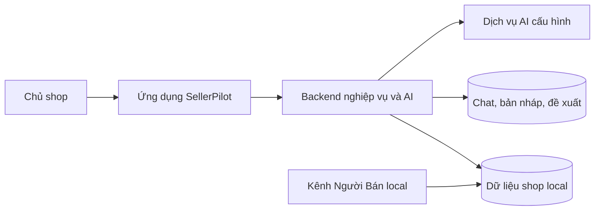
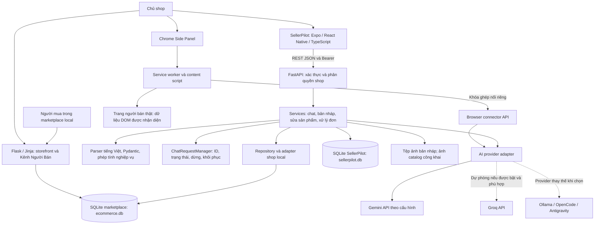
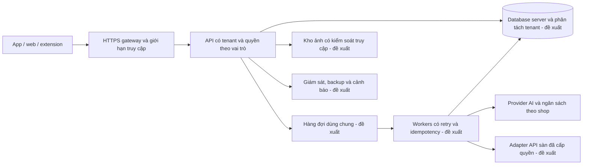
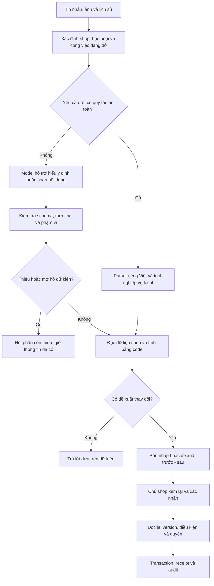
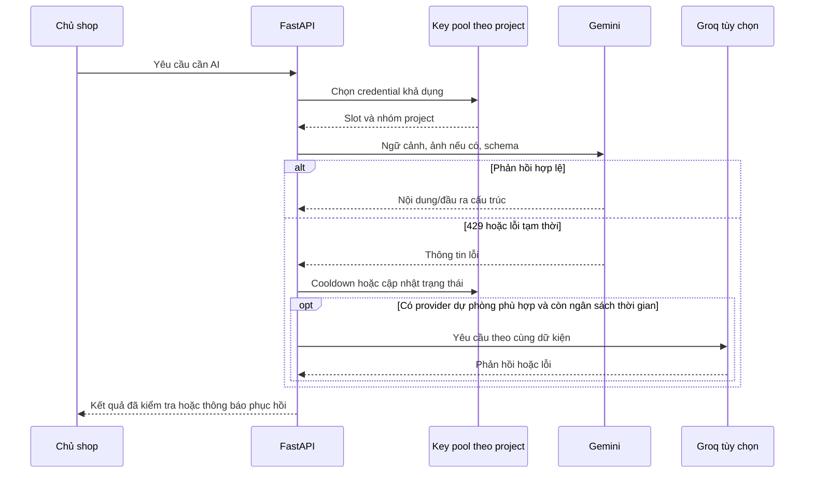
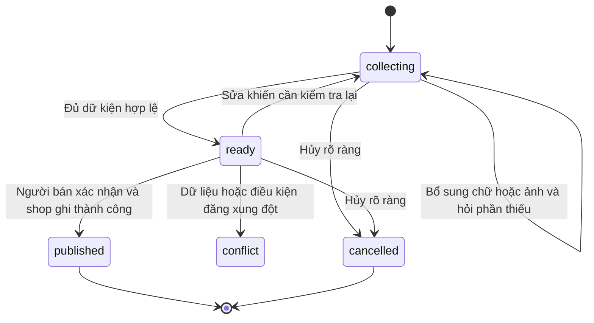
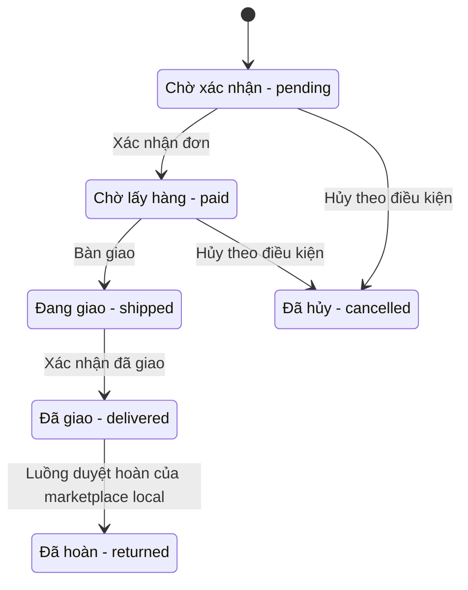
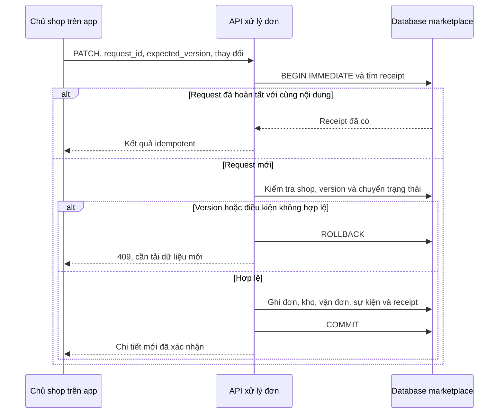
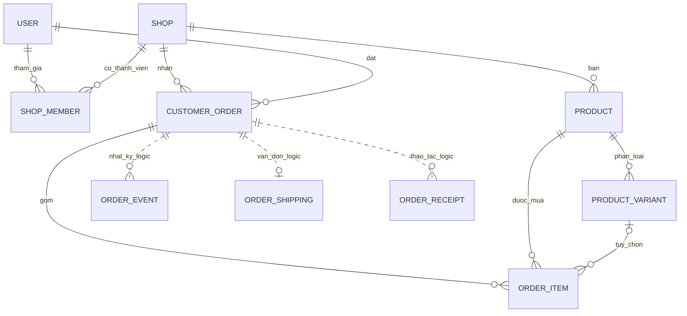

# THUYẾT MINH DỰ ÁN SHIPCODE SELLERPILOT

**Cuộc thi UTE SV-STARTUP 2026 – “Sinh viên với ý tưởng khởi nghiệp”**

**Tên dự án:** SellerPilot – Trợ lý kinh doanh thông minh cho người bán hàng trực tuyến.  
**Nhóm thực hiện:** ShipCode.  
**Đơn vị:** Trường Đại học Công nghệ Kỹ thuật TP.HCM – HCMUTE, theo tên đơn vị trong mẫu.  
**Chuyên ngành của các thành viên:** Kỹ thuật dữ liệu.  
**Lĩnh vực đề xuất:** Công nghệ thông tin, trí tuệ nhân tạo ứng dụng trong thương mại điện tử; cần đối chiếu tên nhóm lĩnh vực chính thức trong thể lệ khi đăng ký.  
**Địa điểm, thời gian:** TP. Hồ Chí Minh, tháng 10 năm 2026.  
**Ngày cập nhật tài liệu:** 25/10/2026.  
**Mã nguồn đối chiếu:** commit `2d96162` và các thành phần đang có trong repository.

> **Cách sử dụng:** Tài liệu bám mẫu `Mẫu_Thuyết_Minh_Dự_Án.docx` trong thư mục gốc. **Phần A** là nội dung thuyết minh để chuyển vào Word; **Phần B** là hồ sơ kỹ thuật, bảng tính và minh chứng để nhóm hiểu, chọn hình và chuẩn bị phản biện. Mẫu giới hạn bài nộp **10 trang A4, Times New Roman, cỡ 14, tiếng Việt**: không đưa toàn bộ phụ lục vào bản nộp 10 trang. Markdown không cố định phân trang; phải kiểm tra lại số trang sau khi dàn Word. Những chỗ `[Nhóm bổ sung]` cần thông tin thật, không dùng thông tin minh họa của mẫu.

## Mục lục

- [Phần A. Thuyết minh theo mẫu](#phan-a)
  - [Thông tin thành viên](#thanh-vien)
  - [Tóm tắt dự án](#tom-tat)
  - [I. Tổng quan đề án – Business Model Canvas](#business-model-canvas)
  - [II. Mô tả thêm về sản phẩm, dịch vụ](#mo-ta-san-pham)
    - [1. Tính cần thiết](#tinh-can-thiet)
    - [2. Tính khả thi](#tinh-kha-thi)
    - [3. Tính độc đáo, sáng tạo](#tinh-sang-tao)
    - [4. Kế hoạch sản xuất, kinh doanh](#ke-hoach)
    - [5. Kết quả tiềm năng](#ket-qua-tiem-nang)
    - [6. Nguồn lực thực hiện](#nguon-luc)
    - [7. Các kênh truyền thông](#truyen-thong)
- [Phần B. Phụ lục kỹ thuật và căn cứ](#phan-b)
  - [B1. Phạm vi đã triển khai và giới hạn](#pham-vi)
  - [B2. Kiến trúc hệ thống](#kien-truc)
  - [B3. Luồng trợ lý AI và ngôn ngữ tiếng Việt](#luong-ai)
  - [B4. Bản nháp, xác nhận và xử lý đơn](#luong-nghiep-vu)
  - [B5. Thiết kế dữ liệu](#du-lieu)
  - [B6. Bảo mật, độ tin cậy và kiểm thử](#bao-mat)
  - [B7. Mô hình tài chính chi tiết](#tai-chinh)
  - [B8. Kế hoạch thử nghiệm, rủi ro và phát triển](#pilot)
  - [B9. Đối chiếu mẫu, dàn trang và hồ sơ cần bổ sung](#doi-chieu-mau)
  - [B10. Tài liệu tham khảo và đường dẫn mã nguồn](#tham-khao)

<a id="phan-a"></a>

# PHẦN A. THUYẾT MINH THEO MẪU

<a id="thanh-vien"></a>

## Thông tin vắn tắt về các thành viên tham gia dự án

**Họ và tên trưởng nhóm:** Bùi Nguyễn Nguyên Khang.  
**Trường:** HCMUTE – Trường Đại học Công nghệ Kỹ thuật TP.HCM, theo mẫu.  
**Chuyên ngành:** Kỹ thuật dữ liệu.  
**Sinh viên năm:** `[Nhóm bổ sung]`.  
**Số điện thoại trưởng nhóm:** `[Nhóm bổ sung]`.  
**Email trưởng nhóm:** `[Nhóm bổ sung]`.

| STT | Họ và tên | Trường | Chuyên ngành | Vai trò |
| --- | --- | --- | --- | --- |
| 1 | Bùi Nguyễn Nguyên Khang | HCMUTE | Kỹ thuật dữ liệu | Trưởng nhóm – Thiết kế hệ thống, AI |
| 2 | Trần Công Thạch | HCMUTE | Kỹ thuật dữ liệu | Kiểm thử hệ thống AI |
| 3 | Lê Minh Hoàng | HCMUTE | Kỹ thuật dữ liệu | Thiết kế hệ thống, extension |
| 4 | Phạm Thế Quân | HCMUTE | Kỹ thuật dữ liệu | Tìm kiếm, thu thập dữ liệu |
| 5 | Huỳnh Cao Trung Đức | HCMUTE | Kỹ thuật dữ liệu | Tìm kiếm, thu thập dữ liệu |

**Danh sách người hướng dẫn:** `[Nhóm bổ sung họ tên, đơn vị công tác, vai trò và nhiệm vụ hướng dẫn; nếu chưa có phải ghi đúng trạng thái thực tế]`.

<a id="tom-tat"></a>

## Tóm tắt dự án

### Ý tưởng chính của dự án

SellerPilot giúp chủ shop xem số liệu, soạn sản phẩm và xử lý đơn bằng hội thoại tiếng Việt có xác nhận thao tác.

### Mô tả sản phẩm, dịch vụ và giá trị của dự án

SellerPilot gồm app di động/web, backend và extension. Chủ shop hỏi số liệu, soạn hàng từ ảnh, sửa sản phẩm và xử lý đơn; thay đổi cần duyệt trước khi ghi. MVP chạy trên marketplace local, còn API sàn chính thức thuộc lộ trình. Sản phẩm hướng đến giảm thao tác và hỗ trợ quyết định từ dữ liệu.

<a id="business-model-canvas"></a>

## I. TỔNG QUAN ĐỀ ÁN – BUSINESS MODEL CANVAS

Mô hình dưới đây trình bày chín khối cốt lõi. Các đối tác, gói thu phí và kênh tăng trưởng là **đề xuất kinh doanh**, chưa phải hợp đồng hay doanh thu đã có.

<table>
  <tr>
    <th>ĐỐI TÁC CHÍNH</th>
    <th>HOẠT ĐỘNG CHÍNH</th>
    <th>GIẢI PHÁP GIÁ TRỊ</th>
    <th>QUAN HỆ KHÁCH HÀNG</th>
    <th>PHÂN KHÚC KHÁCH HÀNG</th>
  </tr>
  <tr>
    <td rowspan="3">Chủ shop tham gia thử nghiệm; cố vấn HCMUTE; nhà cung cấp AI và hạ tầng; sàn TMĐT khi được cấp quyền tích hợp.</td>
    <td>Phát triển phần mềm; kiểm thử AI/nghiệp vụ; chuẩn hóa dữ liệu; hỗ trợ và đánh giá pilot.</td>
    <td rowspan="3">Hỏi bằng tiếng Việt, trả lời theo dữ liệu shop; soạn sản phẩm từ ảnh; quản lý đơn; đề xuất hành động có xác nhận trong cùng công cụ.</td>
    <td>Tự phục vụ có hướng dẫn; hỗ trợ trực tiếp giai đoạn đầu; tiếp nhận phản hồi; cộng đồng người bán.</td>
    <td rowspan="3">Ưu tiên chủ shop nhỏ tại Việt Nam, ít nhân sự, tự quản lý sản phẩm và đơn hàng; sau đó mở rộng tới nhóm vận hành shop.</td>
  </tr>
  <tr>
    <th>TÀI NGUYÊN CHÍNH</th>
    <th>KÊNH THÔNG TIN VÀ PHÂN PHỐI</th>
  </tr>
  <tr>
    <td>Đội ngũ 5 thành viên; mã nguồn; bộ kiểm thử; bộ dữ liệu được phép dùng; adapter nghiệp vụ và cấu hình AI.</td>
    <td>Ứng dụng/web; extension; video tình huống thực tế; cộng đồng nhà bán hàng; giới thiệu từ shop pilot.</td>
  </tr>
  <tr>
    <th colspan="2">CẤU TRÚC CHI PHÍ</th>
    <th colspan="3">DÒNG DOANH THU</th>
  </tr>
  <tr>
    <td colspan="2">Phát triển và kiểm thử; API AI; máy chủ/lưu trữ; bảo trì tích hợp; chăm sóc khách hàng; truyền thông và quản trị.</td>
    <td colspan="3">Dự kiến thuê bao theo shop/tháng; dịch vụ khởi tạo/hướng dẫn tùy nhu cầu. Chưa tính doanh thu quảng cáo, bán dữ liệu hay hoa hồng giao dịch.</td>
  </tr>
</table>

<a id="mo-ta-san-pham"></a>

## II. MÔ TẢ THÊM VỀ SẢN PHẨM, DỊCH VỤ

<a id="tinh-can-thiet"></a>

### 1. Tính cần thiết của sản phẩm, dịch vụ

#### 1.1. Vấn đề và khách hàng quan trọng nhất

Chủ shop nhỏ thường cùng lúc theo dõi đơn, kiểm tra tồn, chỉnh nội dung sản phẩm và làm truyền thông. Khó khăn không chỉ là thiếu báo cáo mà còn là chuyển từ báo cáo sang việc nên làm: mặt hàng nào cần nhập, đơn nào cần xử lý và sản phẩm nào nên ưu tiên nội dung bán hàng.

Bộ Công Thương ghi nhận quy mô thương mại điện tử Việt Nam năm 2024 vượt 25 tỷ USD, tăng khoảng 20% so với năm trước. Đây là căn cứ về quy mô lĩnh vực, **không phải số người sẵn sàng trả tiền cho SellerPilot**. Nhu cầu và mức sẵn sàng chi trả của phân khúc mục tiêu vẫn phải xác minh qua phỏng vấn/pilot. [Nguồn Bộ Công Thương](https://moit.gov.vn/tin-tuc/hoat-dong/hoat-dong-cua-cac-don-vi/cuc-thuong-mai-dien-tu-va-kinh-te-so-to-chuc-hoi-nghi-tong-ket-cong-tac-nam-2024-va-trien-khai-nhiem-vu-nam-2025.html).

Khách hàng ưu tiên là chủ shop tại Việt Nam có ít nhân sự, trực tiếp vận hành và muốn sử dụng công cụ bằng tiếng Việt. Mức 20–500 đơn/tháng được dùng làm giả thuyết tuyển mẫu ban đầu, chưa phải kết quả khảo sát.

#### 1.2. Sản phẩm hiện có, mục tiêu và tầm nhìn

Nhóm đã có phiên bản phần mềm hoạt động, gồm năm tab Quản lý, Sản phẩm, Trợ lý, Đơn hàng và Shop; backend AI/nghiệp vụ; marketplace local và extension. Đây là MVP có thể trình diễn luồng hoàn chỉnh trên dữ liệu mô phỏng, chưa phải dịch vụ đã triển khai thương mại trên diện rộng.

Mục tiêu gần là giúp người bán hoàn thành ba việc: hiểu tình hình kinh doanh; tạo/chỉnh nội dung sản phẩm có kiểm soát; xử lý đơn nhất quán giữa app và Kênh Người Bán local. Tầm nhìn là trở thành trợ lý vận hành hằng ngày, phát triển kết nối sàn thật khi đáp ứng điều kiện cấp quyền và bảo mật.

#### 1.3. Giá trị và lý do lựa chọn

Người bán có thể hỏi “Hôm nay được bao nhiêu đơn?”, “Hàng nào sắp hết?” hoặc gửi ảnh và thông tin để soạn sản phẩm. Số liệu được backend tính; AI hỗ trợ hiểu và diễn đạt. Khi thiếu giá, tồn hoặc chưa xác định được sản phẩm, hệ thống hỏi thêm thay vì tự chốt. Đổi giá, sửa sản phẩm và đăng hàng có bước xem lại/xác nhận.

Giá trị xã hội kỳ vọng là giúp hộ kinh doanh nhỏ tiếp cận công cụ số, giảm công việc thủ công và tăng khả năng đọc hiểu dữ liệu. Nhóm sẽ đo thời gian thao tác, tỷ lệ hoàn thành và phản hồi sử dụng; hiện chưa có số liệu tác động cộng đồng đủ để công bố kết quả định lượng.

<a id="tinh-kha-thi"></a>

### 2. Tính khả thi

#### 2.1. Khả thi về công nghệ và quy trình cung cấp

Ứng dụng dùng Expo/React Native/TypeScript; backend dùng FastAPI/Pydantic; marketplace local dùng Flask. App và website dùng chung database nghiệp vụ, còn lịch sử chat, bản nháp và đề xuất được lưu riêng. Các chức năng đã có mã nguồn gồm tra cứu số liệu, quản lý sản phẩm, xử lý đơn, tạo nội dung từ ảnh, kiểm soát thay đổi đồng thời và phục hồi yêu cầu bị mất phản hồi.



Khả thi được thể hiện qua mã nguồn và kiểm thử, không đồng nghĩa đã đạt độ ổn định phục vụ hàng nghìn shop. MVP cần kết nối mạng cho API AI; câu tra cứu rõ ràng có thể xử lý bằng quy tắc và dữ liệu local. Extension là hướng hỗ trợ thao tác trên trình duyệt, không thay thế quyền tích hợp chính thức của sàn.

#### 2.2. Chi phí, giá thành và khả năng cạnh tranh

Mô hình dự kiến là SaaS theo shop/tháng, thử mức 99.000 đồng cho gói cơ bản và 199.000 đồng cho gói nâng cao. Với giả định cơ cấu 70%/30%, doanh thu thuê bao bình quân là 129.000 đồng/shop-tháng; biến phí kế hoạch là 25.000 đồng/shop-tháng. Đây là giả định để kiểm tra mô hình, chưa phải bảng giá phát hành hay báo giá API đã chốt.

Thuận lợi là nhóm đã có MVP và năng lực kỹ thuật phù hợp, có thể tận dụng thiết bị sẵn có và phần mềm nguồn mở. Khó khăn gồm biến động chi phí/quota AI, chất lượng ảnh và tiếng Việt, thay đổi giao diện sàn, giới hạn cấp quyền API, nguồn lực hỗ trợ và bảo mật dữ liệu người bán.

Thị trường đã có KiotViet và Sapo cung cấp quản lý bán hàng; Sapo cũng công bố giải pháp tích hợp AI. Vì vậy, nhóm không định vị “duy nhất có AI”. Lợi thế cần chứng minh là trải nghiệm tiếng Việt gọn, số liệu có căn cứ và thao tác có xác nhận phù hợp một nhóm shop cụ thể. [KiotViet](https://www.kiotviet.vn/dung-thu-phan-mem-quan-ly-ban-hang-kiotviet/), [Sapo](https://help.sapo.vn/).

<a id="tinh-sang-tao"></a>

### 3. Tính độc đáo, sáng tạo

SellerPilot kết hợp bốn hướng thiết kế:

1. **Hội thoại gắn với nghiệp vụ:** hỏi số liệu, soạn sản phẩm, xem đơn và chuyển tới thao tác liên quan trong cùng ứng dụng.
2. **Tiếng Việt theo ngữ cảnh bán hàng:** chuẩn hóa cách ghi tiền, SKU, tồn và thời gian; ví dụ “5 xị” thành 500.000 đồng trong ngữ cảnh phù hợp. Trường hợp mơ hồ cần xác nhận thêm.
3. **AI có ranh giới:** backend tính toán và quyết định thao tác được phép; model không tự chạy SQL, không tự đặt giá/tồn và không tự phê duyệt thay người bán.
4. **Thiết kế chống tác động trùng:** mã yêu cầu, version và biên nhận xử lý giúp hạn chế việc gửi lại gây ghi trùng hoặc hai phiên ghi đè nhau.

Sáng tạo nằm ở cách tổ chức trải nghiệm và kiểm soát nghiệp vụ, không phải phát minh một mô hình nền tảng mới. Nhóm không khẳng định công nghệ không thể sao chép hoặc có ưu thế chi phí vượt trội khi chưa so sánh bằng thực nghiệm. Giá trị cạnh tranh dài hạn cần đến từ chất lượng tích hợp, bộ kiểm thử, dữ liệu được phép sử dụng và mức gắn bó của khách hàng.

<a id="ke-hoach"></a>

### 4. Kế hoạch sản xuất, kinh doanh

#### 4.1. Lộ trình cung cấp dịch vụ

| Giai đoạn sau khi thống nhất triển khai | Hoạt động chính | Điều kiện chuyển bước |
| --- | --- | --- |
| Tháng 1–3 | Phỏng vấn người bán, hoàn thiện ba luồng cốt lõi, rà soát bảo mật và quyền tích hợp | Có dữ liệu nhu cầu; các luồng nghiệm thu đạt; xác định cách kết nối hợp lệ |
| Tháng 4–6 | Pilot giới hạn, đào tạo và đo thao tác; thử mức giá | Shop có sự đồng ý rõ ràng; số liệu không lẫn nguồn; xử lý sự cố được ghi nhận |
| Tháng 7–12 | Phát hành có giới hạn, tối ưu chi phí AI và hỗ trợ; mở rộng từng đợt | Chi phí phục vụ nằm trong ngân sách, giữ chân khách và chất lượng đạt ngưỡng |
| Năm 2–3 | Mở rộng kết nối được cấp quyền, quản lý nhiều shop và hạ tầng nhiều người dùng | Hoàn tất thay đổi dữ liệu/kiến trúc và kiểm thử quy mô trước khi nhận tải mới |

Quy trình phát triển là thu thập tình huống → đặc tả → xây dựng → kiểm thử → pilot → đánh giá → phát hành. Không bật ghi tự động lên sàn thật khi mới kiểm tra được việc điền form.

#### 4.2. Phân phối, mở rộng và rủi ro

Giai đoạn đầu dùng web/app và cài extension có hướng dẫn cho nhóm pilot. Phân phối rộng qua kho ứng dụng hoặc cửa hàng extension chỉ thực hiện sau khi đáp ứng yêu cầu xét duyệt. Tuyển người dùng qua cộng đồng người bán và giới thiệu từ shop thử nghiệm; mở rộng theo từng ngành hàng có nhu cầu được xác minh.

Các rủi ro chính là AI trả sai, quota/timeout, sai lệch số liệu, thao tác lặp, chưa được cấp quyền sàn và chi phí thu hút khách cao. Biện pháp tương ứng là kiểm tra đầu vào/đầu ra, đường xử lý quy tắc, dự phòng có giới hạn, transaction/receipt/version, tách phạm vi local với trình duyệt và kiểm tra đơn vị kinh tế trước khi tăng trưởng. Rủi ro giao diện sàn thay đổi phải có cơ chế dừng điền và yêu cầu chủ shop kiểm tra.

<a id="ket-qua-tiem-nang"></a>

### 5. Kết quả tiềm năng của dự án

#### 5.1. Nguồn thu, doanh thu và chi phí dự kiến

Nguồn thu chính dự kiến là thuê bao. Dịch vụ khởi tạo hoặc đào tạo có thể bổ sung sau nhưng **chưa đưa vào bảng dự báo**, tránh cộng doanh thu chưa có cơ sở. Tất cả số dưới đây là kịch bản kế hoạch, chưa phải doanh thu thực hiện; đơn vị tiền là triệu đồng, chưa tính VAT.

| Chỉ tiêu | Năm 1 | Năm 2 | Năm 3 |
| --- | ---: | ---: | ---: |
| Tổng shop-tháng trả phí | 700 | 4.200 | 10.800 |
| Doanh thu thuê bao | 90,30 | 541,80 | 1.393,20 |
| Biến phí phục vụ | 17,50 | 105,00 | 270,00 |
| Định phí vận hành | 72,00 | 216,00 | 540,00 |
| Thặng dư vận hành trước thuế | 0,80 | 220,80 | 583,20 |

Chi đầu tư ban đầu giả định 36 triệu đồng, theo dõi riêng với chi phí vận hành trong bảng. Năm 1 áp dụng mô hình nhóm sinh viên với phụ cấp, chưa phản ánh mức lương toàn thời gian theo thị trường. Khi thương mại hóa, phải cập nhật lương, bảo hiểm, thuế, khấu hao và chi phí tuân thủ trước khi dùng các số này để quyết định đầu tư.

#### 5.2. Hòa vốn, hoàn vốn và tăng trưởng

Biên đóng góp giả định là 129.000 − 25.000 = **104.000 đồng/shop-tháng**. Với định phí năm đầu 6 triệu đồng/tháng, hòa vốn vận hành cần ít nhất **58 shop trả phí đang hoạt động**. Khi định phí tăng lên 18 triệu đồng/tháng ở năm 2, ngưỡng này tăng thành **174 shop**.

Theo tiến độ thu phí tại phụ lục B7, dòng tiền lũy kế sau chi đầu tư ban đầu chuyển dương khoảng **tháng 17**. Nhu cầu bù thiếu hụt lớn nhất khoảng 66,04 triệu đồng; đề xuất chuẩn bị 80 triệu đồng gồm phần này và dự phòng. Hoàn vốn phụ thuộc việc đạt số shop và giữ biến phí như giả định. Nếu biến phí tăng lên 50.000 đồng/shop-tháng, năm 1 lỗ vận hành khoảng 16,70 triệu đồng thay vì gần hòa vốn.

Khả năng tăng trưởng được đánh giá bằng khách hàng trả phí, duy trì sử dụng, chi phí phục vụ và khả năng tích hợp, không suy từ tổng quy mô TMĐT. Tác động xã hội sẽ được đo qua thời gian tiết kiệm, khả năng hoàn thành công việc và mức tiếp cận công cụ số của shop nhỏ.

<a id="nguon-luc"></a>

### 6. Nguồn lực thực hiện

Nhóm có năm thành viên ngành Kỹ thuật dữ liệu, phân công như hồ sơ đầu tài liệu. Trưởng nhóm phụ trách thiết kế hệ thống/AI; thành viên kiểm thử phụ trách chất lượng AI; thành viên hệ thống/extension phụ trách luồng trình duyệt; hai thành viên dữ liệu phụ trách nguồn dữ liệu, tình huống và hỗ trợ khảo sát. Ma trận nhiệm vụ cụ thể tại phụ lục B8 là đề xuất để nhóm xác nhận.

Nguồn lực đã có gồm mã nguồn, thiết bị phát triển hiện có và bộ kiểm thử. **Chưa có thông tin được xác nhận về doanh nghiệp cố vấn, hợp đồng đối tác, vốn đã nhận hoặc cam kết tài trợ**. Nhóm dự kiến tìm người hướng dẫn, shop pilot và đơn vị hỗ trợ khởi nghiệp; chỉ ghi tên đối tác khi có sự đồng ý.

Phương án vốn đề xuất là 20 triệu đồng đóng góp nhóm và 60 triệu đồng tìm từ hỗ trợ khởi nghiệp/tài trợ hoặc nguồn phù hợp, tổng 80 triệu đồng. Đây là phương án huy động, không phải tiền đã có hay cam kết của từng thành viên/gia đình. Nhóm cần thống nhất đóng góp, quyền sở hữu mã nguồn, trách nhiệm công việc và cách quyết định sử dụng vốn trước khi triển khai thu phí.

<a id="truyen-thong"></a>

### 7. Các kênh truyền thông

Thông điệp chính là **“SellerPilot – Hiểu số liệu, chủ động bán hàng”**. Nội dung tập trung vào tình huống người bán gặp hằng ngày: xem shop hôm nay, tìm hàng sắp hết, soạn sản phẩm từ ảnh và xử lý một đơn hàng. Video cần thể hiện thao tác thật của phiên bản đang có, phân biệt nguồn local và luồng trình duyệt.

| Kênh | Nội dung/công cụ | Cách đánh giá |
| --- | --- | --- |
| TikTok, Reels, YouTube Shorts | Video ngắn một vấn đề – một luồng xử lý, quay màn hình có lời giải thích | Lượt xem đủ thời lượng, nhấp có gắn nguồn, đăng ký trải nghiệm |
| Cộng đồng người bán | Hướng dẫn vận hành, phiên hỏi đáp, mời pilot đúng nội quy | Người đăng ký đủ tiêu chí và tỷ lệ tham gia pilot |
| Landing page/web giới thiệu | Mô tả phạm vi, video, biểu mẫu đăng ký và chính sách dữ liệu | Tỷ lệ đăng ký → kích hoạt; nguồn truy cập |
| Giới thiệu từ shop pilot | Chia sẻ tình huống và nhận xét có sự đồng ý | Shop được giới thiệu, tiếp tục dùng và chuyển trả phí |
| Hoạt động HCMUTE/cuộc thi | Trình diễn sản phẩm, nhận phản biện, tìm cố vấn | Cuộc hẹn khảo sát, phản hồi chất lượng và cơ hội hợp tác |

Điểm khác biệt truyền thông là trình diễn đường đi từ câu hỏi tới số liệu và quyết định, có kết quả trước/sau đo được. Đánh giá hiệu quả dựa trên phễu tiếp cận → đăng ký → kích hoạt → dùng thường xuyên → trả phí. Không dùng lượt xem để khẳng định tăng doanh số; chưa có hệ thống ghi nguồn thì đánh dấu chưa đo được. Lịch triển khai và chỉ tiêu thử nghiệm được trình bày tại B8.

---

<a id="phan-b"></a>

# PHẦN B. PHỤ LỤC KỸ THUẬT VÀ CĂN CỨ

Phần này dành cho nhóm phát triển, người hướng dẫn và chuẩn bị phản biện. Có thể chọn một số hình/bảng để đưa vào phần A, nhưng không tự động gộp toàn bộ vào bài dự thi 10 trang.

<a id="pham-vi"></a>

## B1. Phạm vi đã triển khai và giới hạn

### B1.1. Định vị đúng sản phẩm

SellerPilot là trợ lý **cho người bán**, không phải hệ thống tự mua hàng hay chatbot tự chăm sóc khách trên mọi nền tảng. Phiên bản local có một shop do server cấu hình; dữ liệu marketplace có nhiều shop để kiểm thử cách ly, nhưng điều đó chưa biến backend thành SaaS nhiều tenant tự đăng ký.

Website trong `UTE MALL/` mô phỏng giao diện/quy trình mua bán. Việc app và website cùng ghi dữ liệu local không phải bằng chứng đồng bộ với Shopee chính thức. Extension là kênh khác, dùng trang người bán đang đăng nhập và dữ liệu trình duyệt nhận diện được.

### B1.2. Ma trận khả năng

| Khả năng | Trạng thái trong source | Phạm vi cần nêu khi trình bày |
| --- | --- | --- |
| Dashboard ngày cụ thể, hôm nay/7/30 ngày | Đã triển khai | Tính trên database shop local; không phải dữ liệu Analytics của sàn thật |
| Tra cứu sản phẩm, SKU, tồn thấp | Đã triển khai | Backend kiểm tra toàn danh mục local trong phạm vi shop |
| Tính giá/lời theo chi phí được cung cấp | Đã triển khai | Kết quả phụ thuộc giá vốn/phí; không tự có đầy đủ sổ kế toán |
| Kế hoạch bán hàng, kịch bản video | Đã triển khai | Đề xuất để người bán thực hiện; chưa tự chạy quảng cáo hoặc đo chuyển đổi video |
| Soạn sản phẩm từ chữ và tối đa 6 ảnh | Đã triển khai | Thu thập thông tin → bản nháp → duyệt; không suy giá/tồn từ ảnh |
| Sửa tên, mô tả, giá, tồn thủ công/qua chat | Đã triển khai | Chọn đúng SKU/biến thể, kiểm tra trước/sau, xác nhận trên shop local |
| Xử lý đơn, vận đơn, lịch sử | Đã triển khai | Quy tắc trạng thái local; chưa gọi hãng vận chuyển thật |
| Lịch sử chat, ghim/xóa, bộ nhớ shop/SKU | Đã triển khai | Bộ nhớ không phải mô hình do nhóm tự huấn luyện |
| Tải lại yêu cầu sau mất phản hồi, dừng AI | Đã triển khai | Dựa trên ID/trạng thái yêu cầu; không tự phát lại tác vụ bị ngắt khi server khởi động lại |
| Face ID/Touch ID | Có luồng native | Bảo vệ mở khóa token trên thiết bị hỗ trợ; cần native build, không cam kết Face ID chạy trong Expo Go |
| Extension Shopee | Có đọc/điền form và đồng bộ danh sách có giới hạn | DOM/phân trang thay đổi có thể làm thiếu dữ liệu; chưa có bằng chứng nghiệp vụ tương đương app |
| Extension TikTok Shop | Có manifest, content script và fixture | Là adapter trình duyệt thử nghiệm; không phải TikTok Shop Open API hay TikTok Analytics |
| API chính thức Shopee/TikTok Shop | Chưa có bằng chứng tích hợp trong phiên bản đối chiếu | Chỉ đưa vào lộ trình sau cấp quyền và kiểm thử |
| SaaS nhiều shop, thu tiền thuê bao, app store công khai | Kế hoạch | Chưa coi cấu hình build hoặc giá đề xuất là tính năng thương mại đã phát hành |
| AI dự báo doanh số/tối ưu quảng cáo tự động | Chưa triển khai | Phân tích mô tả và kế hoạch gợi ý không phải mô hình dự báo đã được đánh giá |

### B1.3. Giá trị thể hiện qua năm tab

- **Quản lý:** số đơn/giá trị đơn, so sánh cùng thời lượng, biểu đồ, hàng cần chú ý và đường dẫn tới công việc.
- **Sản phẩm:** danh mục có ảnh, tìm kiếm, SKU/biến thể, form sửa và xem lại thay đổi.
- **Trợ lý:** hội thoại, ảnh đính kèm, lịch sử, bản nháp, tính chi phí và gợi ý kế hoạch.
- **Đơn hàng:** danh sách, lọc/tìm, chi tiết, tiến trình, ghi chú, vận đơn và thao tác hợp lệ.
- **Shop:** thông tin nguồn dữ liệu, tài khoản đang liên kết, giao diện và thiết lập bảo mật phù hợp.

### B1.4. Những khẳng định cần tránh

Không trình bày dữ liệu mô phỏng thành khách hàng/doanh thu thật; không gọi bản đọc DOM là API chính thức; không khẳng định 3 key tạo quota gấp 3; không hứa video chắc chắn ra đơn; không coi “đã điền form” là “đã đăng lên sàn”; không coi bài test fixture là bằng chứng chạy được trên mọi thiết bị/giao diện.

<a id="kien-truc"></a>

## B2. Kiến trúc hệ thống

### B2.1. Sơ đồ kiến trúc hiện tại



**Cách đọc:** nhánh local đọc/ghi database nghiệp vụ qua repository; nhánh extension dùng ngữ cảnh trang, có xác thực ghép nối riêng. Không có mũi tên trực tiếp từ model tới database hay từ extension tới database shop thật của Shopee.

### B2.2. Vai trò từng lớp

| Lớp | Trách nhiệm | Không được suy thành |
| --- | --- | --- |
| UI | Nhận thao tác, hiển thị số liệu/bản nháp, cho xem lại và xác nhận | Nguồn quyết định giá/tồn cuối cùng ở server |
| API và schemas | Kiểm tra kiểu, giới hạn, phiên và shop | Chỉ kiểm tra bằng giao diện là đủ bảo mật |
| Services | Điều phối nghiệp vụ, trạng thái hội thoại, đề xuất, kết quả | Agent tự chạy công cụ tùy ý |
| Integrations/repository | Đọc dữ liệu đúng shop, cập nhật có transaction | Một adapter đã tích hợp mọi sàn |
| Provider adapter | Chuẩn hóa gọi model, schema, timeout, dự phòng | Chạy đồng thời tất cả provider hoặc bảo đảm luôn miễn phí |
| Persistence | Lưu đơn/sản phẩm và trạng thái chat/đề xuất theo trách nhiệm | Hai database có transaction phân tán nguyên khối |

### B2.3. Hai database và nguồn dữ liệu thống nhất

**Database marketplace** chứa `user`, `shop`, `shop_member`, `product`, `product_variant`, `order`, `order_item`, review và các bảng vận hành. App và Flask cùng đọc/ghi database này; vì vậy việc thay đổi đơn local không cần sao chép số liệu sang một database sản phẩm khác.

**Database SellerPilot** chứa `seller_session`, `seller_login_attempt`, `chat_request`, `agent_run`, `conversation_state`, `product_draft`, `action_proposal`, `action_audit`, `product_edit_proposal`, `product_edit_audit` và `assistant_memory`.

Các bảng receipt/journal nằm trong database marketplace để gắn với transaction cập nhật nghiệp vụ. Sau khi shop commit, backend có thể hoàn tất audit ở database SellerPilot dựa trên receipt khi khôi phục. Đây là cơ chế phục hồi có biên nhận, **không phải cam kết ACID xuyên hai database**.

### B2.4. Triển khai hiện tại

`npm run demo` điều phối marketplace trên cổng 5011, FastAPI trên 8000 và Expo trên 8081. Hai dịch vụ Python dùng virtualenv riêng. Launcher kiểm tra phiên bản Python, nguồn database chung và cổng trước khi mở dịch vụ. Gemini/Groq được gọi trực tiếp từ backend; API key không đặt trong bundle mobile.

Trên điện thoại trong mạng LAN, app kết nối API của máy chủ phát triển qua địa chỉ phù hợp. Đây là cấu hình trình diễn, không phải thiết kế bảo mật để công khai Internet nguyên trạng.

### B2.5. Kiến trúc phát triển khi thương mại hóa



Phiên bản hiện tại có hàng đợi/khóa trong một tiến trình, giới hạn số yêu cầu đang chờ. Chạy nhiều Uvicorn worker nguyên trạng có thể làm mất tính nhất quán của trạng thái trong bộ nhớ. Trước khi mở rộng phải xây dựng hàng đợi/khóa dùng chung, chuyển đổi các phần SQL phụ thuộc SQLite và đo tải. Sơ đồ tương lai không khẳng định Redis/Celery/PostgreSQL/object storage đã được triển khai.

<a id="luong-ai"></a>

## B3. Luồng trợ lý AI và xử lý ngôn ngữ tiếng Việt

### B3.1. Phân tuyến câu hỏi



Đây là sự kết hợp **NLP theo quy tắc, ngữ cảnh hội thoại và LLM có đầu ra kiểm tra được**. Repo không chứng minh nhóm đã huấn luyện một mô hình ngôn ngữ riêng, fine-tune mô hình hay có vector database/RAG. Dữ liệu nghiệp vụ chủ yếu được truy vấn bằng repository và đưa vào ngữ cảnh phù hợp.

### B3.2. Ví dụ lệnh và nguyên tắc xử lý

| Người bán nói | Xử lý mong đợi | Điểm kiểm soát |
| --- | --- | --- |
| “Nay được bao nhiêu đơn vậy?” | Chuẩn hóa “nay” → hôm nay, đọc thống kê | Ngày theo múi giờ shop, không để model cộng nhẩm |
| “Tháng này bán sao rồi?” | Xác định tháng lịch đang diễn ra | Phân biệt với 30 ngày trượt |
| “Có hàng nào sắp hết không?” | Tìm tồn thấp theo quy tắc | Ngưỡng mặc định/được nêu rõ; không suy tồn từ doanh thu |
| “Giá 5 xị, còn 12 cái” | Trích 500.000 đồng, tồn 12 trong ngữ cảnh phù hợp | Phân biệt giá vốn với giá bán; số mơ hồ cần hỏi |
| “Tồn 2.000” | Hiểu 2.000 đơn vị | Không đọc thành 2; số lẻ/khoảng không được cắt một phần |
| “Xe đó” khi đang chọn sản phẩm | Xét lịch sử/ảnh và thực thể đang trao đổi | Nếu chưa đủ rõ phải hỏi; không lấy nguyên câu làm tiêu đề |
| “Để sau” | Giữ nháp để tiếp tục | Không đồng nhất với hủy hoặc xóa ảnh |
| “Thôi không sửa nữa” | Bỏ yêu cầu sửa đang chờ theo trạng thái | Không biến câu phủ định thành lệnh cập nhật |
| “Viết video 25 giây cho sản phẩm này” | Dùng dữ kiện sản phẩm và đề xuất cảnh/thoại/CTA | Không bịa thông số, không khẳng định chắc chắn ra đơn |

Ví dụ là tình huống thiết kế/kiểm thử, không phải cam kết hiểu đúng mọi cách nói tiếng Việt.

### B3.3. Khi cần gọi model

Backend cung cấp facts phù hợp, lịch sử trong ngân sách và schema đầu ra cho provider. Model hỗ trợ phân loại, trích ý, viết tiêu đề/mô tả và diễn giải tư vấn. Các trường SKU, tiền, tồn, giới hạn độ dài và trạng thái vẫn phải qua kiểm tra backend. Nội dung trang, tên sản phẩm và văn bản do model sinh là dữ liệu đầu vào không đáng tin để cấp thêm quyền.

Chuỗi JSON bọc nhầm trong câu trả lời được chuẩn hóa trước khi hiển thị. Phản hồi rỗng, bị cắt hoặc không đúng schema được xử lý theo nhóm lỗi; không lấy JSON dở làm nội dung “thành công”. Cơ chế kiểm tra chỉ bao phủ các trường hợp đã đặc tả, không loại bỏ hoàn toàn hallucination.

### B3.4. Quota, xoay key và dự phòng



Cấu hình hỗ trợ tối đa ba key Gemini với project ID. Key cùng project chia sẻ quota/cooldown; key trùng được loại, khai báo mâu thuẫn bị từ chối. HTTP 429 không được giải quyết bằng gọi liên tục; 401/403 vô hiệu credential lỗi trong tiến trình; lỗi nội dung/cấu hình không được che bằng xoay key. Google xác nhận hạn mức được áp theo project, không theo số key. [Tài liệu Gemini](https://ai.google.dev/gemini-api/docs/rate-limits).

Timeout Gemini cấu hình mặc định là 60 giây cho phạm vi sinh nội dung của lượt. Khi bật dự phòng và đáp ứng điều kiện, backend dành một phần thời gian còn lại cho Groq; không cộng vô hạn từng lượt chờ. Thời gian chờ hàng đợi/HTTP không đồng nhất với thời gian suy luận. Model hỗ trợ ảnh, số lượng ảnh và quota phụ thuộc provider cụ thể; không bỏ ảnh người bán gửi chỉ để chuyển sang model ít khả năng hơn.

Gói miễn phí phù hợp thử nghiệm có giới hạn nhưng không phải nền tảng bảo đảm SLA thương mại. Ngân sách kinh doanh phải tính chi phí AI và đo lại trên khối lượng văn bản/ảnh thực tế.

<a id="luong-nghiep-vu"></a>

## B4. Bản nháp, xác nhận và xử lý đơn

### B4.1. Tạo sản phẩm bằng ảnh hoặc hội thoại

1. Người bán chọn tối đa 6 ảnh và nhập thông tin; chọn ảnh chưa đồng nghĩa gửi tin.
2. Backend kiểm tra định dạng/kích thước, liên kết với hội thoại và tạo hoặc bổ sung bản nháp đúng ngữ cảnh.
3. AI soạn tên/mô tả dựa trên dữ kiện; parser trích giá/tồn đã nêu. Thiếu thông tin thì hỏi lại.
4. App hiển thị ảnh, tên, mô tả, ngành hàng, giá, tồn và các phần còn thiếu.
5. Người bán sửa nếu cần rồi xác nhận đăng. Backend kiểm tra lại trạng thái trước khi cập nhật shop local.
6. Sau kết quả được server xác nhận, danh mục được làm mới. Lượt xác nhận lại không được tạo thêm sản phẩm chỉ vì mất phản hồi.



Không được mô tả `ready` là đã có sản phẩm trên sàn. Luồng extension phải phân biệt thêm trạng thái đã điền vào form với việc chủ shop tự hoàn tất lưu/đăng trên trang thật.

### B4.2. Sửa sản phẩm

Form thủ công nhận `request_id`, `expected_version` và các trường thực sự thay đổi. Chat tạo proposal với before/after cho tên, mô tả, giá và tồn. Tiêu đề/mô tả thuộc sản phẩm cha; giá/tồn của sản phẩm có phân loại cần chọn SKU biến thể đúng.

Backend đối chiếu lại dữ liệu tại lúc ghi. Nếu version hoặc trường đang sửa đã đổi, trả xung đột thay vì âm thầm ghi đè. Khi sửa biến thể, giá thấp nhất/tổng tồn khả dụng của sản phẩm cha được cập nhật theo quy tắc. Không cộng tồn sản phẩm cha và tồn biến thể thành hai nguồn hàng độc lập.

### B4.3. Trạng thái đơn hàng và vận chuyển



`paid` là tên trạng thái kỹ thuật hiện được hiển thị “Chờ lấy hàng”; không suy rằng xác nhận đơn đã thu tiền ngân hàng. App quản lý các chuyển trạng thái hợp lệ đang hỗ trợ; hoàn hàng có luồng riêng của marketplace. Hủy hoàn kho theo transaction, không đồng nghĩa đã hoàn tiền qua cổng thanh toán thật.

Đơn vị vận chuyển và mã vận đơn được shop nhập/lưu; chưa có adapter xác minh tracking trực tiếp với hãng. Đơn cũ không có lịch sử đầy đủ phải hiển thị giới hạn; không dựng thời gian giao chỉ để timeline trông hoàn thiện.

### B4.4. Cập nhật đơn khi có thao tác đồng thời



Trigger journal ghi đổi trạng thái từ các nguồn cùng database trong transaction của bên ghi. App gắn operation ID vào sự kiện phù hợp để tránh thêm mốc trùng. Biên nhận tồn tại cùng nghiệp vụ đã commit, giúp một lần thử lại không hoàn kho lần thứ hai.

<a id="du-lieu"></a>

## B5. Thiết kế dữ liệu và giao tiếp API

### B5.1. Mô hình logic của dữ liệu shop



`CUSTOMER_ORDER` là tên dễ đọc trong sơ đồ cho bảng SQL `order`; các tên journal tương ứng `sellerpilot_order_event`, `sellerpilot_order_shipping`, `sellerpilot_order_receipt`. Nét đứt thể hiện liên hệ logic theo ID; không khẳng định tất cả quan hệ này có foreign key vật lý. Khóa phạm vi shop cũng phải được kiểm tra ở truy vấn/nghiệp vụ.

### B5.2. Dữ liệu trợ lý

| Bảng/nhóm | Dữ liệu và vai trò |
| --- | --- |
| `seller_session` | Hash token, user/shop, hạn dùng, dấu thu hồi và fingerprint credential |
| `seller_login_attempt` | Bộ đếm đăng nhập theo khóa băm, phục vụ giới hạn thử sai |
| `chat_request` | Khóa shop + request, fingerprint nội dung, trạng thái và response/error đã lưu |
| `agent_run` | Tin nhắn, trả lời, intent, provider/model, facts, tool và thời gian xử lý |
| `conversation_state` | Ghim/xóa hội thoại theo shop và conversation |
| `product_draft` | Hội thoại, dữ kiện sản phẩm, ảnh tham chiếu, trạng thái và ID sản phẩm khi đăng |
| `action_proposal` / `action_audit` | Đề xuất đổi giá và nhật ký quyết định |
| `product_edit_proposal` / `product_edit_audit` | Đề xuất sửa nhiều trường, before/after và audit |
| `assistant_memory` | Thông tin shop/SKU có phạm vi và evidence; không phải lịch sử toàn bộ người dùng khác |

Ảnh nằm ở tệp, database giữ tham chiếu/thông tin liên quan. Nhật ký chat có thể chứa nội dung kinh doanh nhạy cảm; việc không in key trong log không có nghĩa database chat không cần bảo vệ.

### B5.3. Nguyên tắc tính số liệu

- Lưu/đọc thời gian theo quy ước UTC và trình bày theo `Asia/Ho_Chi_Minh`.
- Dashboard ngày lịch sử lấy đủ ngày; ngày hôm nay chỉ lấy phần thời gian đã trôi qua.
- So sánh kỳ trước cần cùng thời lượng, loại đơn tương lai và tách đơn hủy/hoàn theo định nghĩa chỉ số.
- Giá trị đơn hàng, giá trị đã giao, tiền đã thu và lợi nhuận là các khái niệm khác nhau; không thay tên cho nhau.
- Giá dòng hàng dùng giá tại thời điểm mua, không lấy giá catalog hiện tại để tính lại doanh số cũ.
- Tồn khả dụng lấy biến thể đang hoạt động khi có phân loại; không cộng trùng tồn cha/con.
- Phép tính tư vấn chi phí dùng `Decimal`. Database marketplace kế thừa có trường tiền kiểu `Float`; không mô tả toàn bộ dữ liệu tiền hiện tại là integer. Chuyển sang kiểu tiền thống nhất là việc cần làm trước khi mở rộng hệ thống tài chính.

### B5.4. API tiêu biểu đang có

| Nhóm | Đường dẫn và phương thức | Vai trò |
| --- | --- | --- |
| Xác thực | `POST /api/v1/auth/login`; `GET /auth/me`; `POST /auth/logout` | Đăng nhập, kiểm tra và thu hồi phiên; hai đường sau cùng cũng có tiền tố `/api/v1` |
| Dashboard | `GET /api/v1/management/dashboard?days=1` hoặc `?date=YYYY-MM-DD` | Thống kê theo kỳ/ngày hợp lệ |
| Sản phẩm | `GET /api/v1/management/products`; `GET/PATCH /api/v1/management/products/{id}` | Danh mục, chi tiết và sửa thủ công |
| Đơn hàng | `GET /api/v1/management/orders`; `GET/PATCH /api/v1/management/orders/{id}` | Danh sách, chi tiết, vận đơn và xử lý |
| Hội thoại | `POST /api/v1/chat`; `GET /api/v1/chat/requests/{id}` | Tạo yêu cầu và lấy trạng thái/kết quả |
| Dừng | `POST /api/v1/chat/requests/{id}/cancel` | Hủy yêu cầu theo ID |
| Sửa qua đề xuất | `POST /api/v1/product-edits`; `POST /api/v1/product-edits/{id}/confirm` hoặc `/reject` | Xem lại và quyết định sửa |
| Bộ nhớ | `GET /api/v1/assistant/memory`; `POST /api/v1/assistant/memory/reset` | Xem/xóa bộ nhớ hỗ trợ |
| Extension | `/api/v1/browser-connector/health`, `/requests`, `/requests/{connection_id}/{request_id}` | Ghép nối và yêu cầu theo ngữ cảnh trình duyệt |

API local nghiệp vụ yêu cầu phiên thành viên hợp lệ. Health và luồng connector có chính sách riêng, không lấy khóa connector thay phiên người bán local.

<a id="bao-mat"></a>

## B6. Bảo mật, độ tin cậy và kiểm thử

### B6.1. Xác thực và dữ liệu riêng tư

Phiên API dùng token ngẫu nhiên; database lưu SHA-256 của token. Server kiểm tra user, thành viên shop, hạn dùng và dấu thay đổi credential. Web giữ token trong bộ nhớ; native dùng SecureStore, có thể yêu cầu Face ID/Touch ID để mở khóa trên thiết bị hỗ trợ. Face ID không thay thế quyền truy cập server và ứng dụng không nhận/lưu ảnh khuôn mặt từ cơ chế này.

Lệnh phục hồi tài khoản tạo PBKDF2-SHA256 600.000 vòng để dùng chung Flask/FastAPI; môi trường Python 3.11 có hỗ trợ scrypt để đọc hash cũ. Launcher kiểm tra khả năng runtime, tránh trường hợp đăng nhập sập vì Python hệ thống macOS thiếu thuật toán. Cơ chế kiểm tra mật khẩu lỗi không được cho phép truy cập.

API key AI được cấu hình ở backend bằng môi trường riêng; không ghi vào `EXPO_PUBLIC_*`, commit hay tài liệu dự thi. Các endpoint API trả `Cache-Control: no-store`. Ảnh bản nháp chưa đăng được bảo vệ; ảnh đã thành catalog công khai có chính sách khác.

### B6.2. Ranh giới extension

Luồng trình duyệt có khóa ghép nối riêng, kiểm tra nguồn, kết nối/tab và ngữ cảnh trang. Content script không lấy mật khẩu/cookie để chuyển cho AI. Bộ đọc cố giảm dữ liệu xuống các cột/nhãn cần thiết; tên sản phẩm hoặc ảnh do người dùng chọn vẫn có thể chứa thông tin nhạy cảm, nên cần thông báo xử lý dữ liệu khi pilot.

Nhãn shop trên DOM là dấu hiệu do người dùng xác nhận, không phải Shop ID được sàn xác thực qua API. Danh sách chỉ được coi có độ phủ tương ứng khi nhận diện đúng phân trang/bộ lọc và điều kiện đọc. Cache tách theo kết nối/nhãn, không được dùng dữ liệu local để lấp số thiếu của sàn thật.

### B6.3. Độ tin cậy và hạn chế hiện tại

| Tình huống | Cơ chế đã có | Giới hạn còn lại |
| --- | --- | --- |
| Người dùng bấm gửi/thử lại nhiều lần | Request ID và fingerprint, kết quả đã lưu | Nội dung khác phải dùng ID mới; cần giữ identity phía client |
| Mất kết nối khi server đã xong | Lấy lại trạng thái/kết quả theo ID | Không bảo đảm luôn có mạng hoặc thiết bị không mất dữ liệu cục bộ |
| Backend khởi động lại giữa lượt | Đánh dấu interrupted và hướng dẫn kiểm tra | Không tự chạy lại tác vụ ghi chưa rõ kết quả |
| Hai phiên sửa cùng đơn/sản phẩm | Version/before-state và transaction | Có thể nhận 409, người bán cần xem dữ liệu mới |
| Lặp xác nhận sau commit | Receipt gắn operation ID | Không phải transaction phân tán giữa mọi nguồn |
| Model timeout/quota | Deadline, cooldown, dự phòng nếu bật và phản hồi có căn cứ | Không có SLA hoặc quota vô hạn |
| UI đổi kỳ | Kiểm tra response đúng kỳ, bỏ phản hồi cũ, cache có hạn | Không phải đồng bộ push realtime với sàn thật |
| Thanh điều hướng quá trong | Lớp tint/frost cố định, tôn trọng Giảm độ trong suốt | Cần kiểm tra trực tiếp trên thiết bị/iOS mục tiêu |
| Logo xuất hiện trễ | Asset UI nhỏ hơn, tải sẵn, không fade mặc định | Cache vẫn phụ thuộc nền tảng và trạng thái thiết bị |

### B6.4. Kế hoạch và minh chứng kiểm thử

Bộ kiểm thử trong repo dùng database/tài khoản/ảnh tổng hợp, không coi các số liệu này là khách hàng thật. Các nhóm chính gồm xác thực, cách ly shop, tiền/tiếng Việt, trạng thái hội thoại, draft/ảnh, truy vấn số liệu, sửa sản phẩm, xử lý đơn, idempotency, rollback, provider và extension.

Repository có bộ kiểm thử backend/marketplace, hướng dẫn QA frontend và cấu hình CI. Khi trích kết quả đạt, số lượng bài kiểm thử hoặc trạng thái build, cần ghi rõ commit, môi trường, lệnh chạy và đính kèm run/log tương ứng. Việc tồn tại test hoặc workflow chưa chứng minh lần chạy mới nhất thành công, cũng không phải chứng nhận hệ thống không còn lỗi.

Lập tài liệu ngày 25/10/2026 chủ yếu đối chiếu source và kiểm tra cấu trúc tài liệu; không mặc định mọi bài test được chạy lại trong ngày này. Trước buổi thi cần chạy smoke test và kiểm tra iPhone thật, Face ID/native build, bàn phím, mạng yếu và DOM sàn đang dùng.

### B6.5. Những việc bắt buộc trước vận hành thương mại

Hoàn thiện phân tách tenant, chính sách dữ liệu và thời hạn lưu; HTTPS, quản trị secret, backup/khôi phục có thử nghiệm; phân quyền phù hợp đội bán hàng; giám sát chi phí AI; quy trình sự cố; đánh giá quyền sử dụng ảnh/logo/dataset. Không phát hành nhận diện mô phỏng Shopee hay bình luận mô phỏng như đánh giá người mua thật. Các yêu cầu pháp lý/điều khoản nền tảng cụ thể cần được rà soát với đơn vị có chuyên môn khi triển khai.

<a id="tai-chinh"></a>

## B7. Mô hình tài chính chi tiết

### B7.1. Phạm vi và giả định

Đây là **mô hình kế hoạch do tài liệu đề xuất**, không được trích như hóa đơn, hợp đồng hay doanh thu đã thực hiện. “Tháng 1” là tháng bắt đầu kế hoạch thương mại sau khi nhóm chốt điều kiện, không tự gán là tháng hiện tại. Không dùng quy mô TMĐT toàn quốc để giả định nhóm sẽ có tỷ lệ thị phần tương ứng.

| Biến | Giả định cơ sở | Điều kiện cần kiểm chứng |
| --- | ---: | --- |
| Giá gói cơ bản/tháng | 99.000 đồng | Phỏng vấn mức sẵn sàng trả, phạm vi sử dụng và định mức AI |
| Giá gói nâng cao/tháng | 199.000 đồng | Khách hàng nhận đủ giá trị, hỗ trợ phù hợp |
| Cơ cấu gói | 70% cơ bản; 30% nâng cao | Không lấy tỷ lệ này làm kết quả bán hàng |
| ARPU theo shop-tháng | 129.000 đồng | `99.000 × 70% + 199.000 × 30%` |
| Biến phí/shop-tháng | 25.000 đồng | Ngân sách AI/hạ tầng/giao dịch, cần đo lại |
| Biên đóng góp/shop-tháng | 104.000 đồng | ARPU trừ biến phí |
| Định phí tháng năm 1/2/3 | 6 / 18 / 45 triệu đồng | Tăng cùng nhân lực, hỗ trợ và quy mô |
| Đầu tư trước vận hành | 36 triệu đồng | Ghi riêng, không khấu trừ hai lần |
| Nguồn vốn mục tiêu | 80 triệu đồng | Chưa phải vốn đã huy động |

Giá trị 25.000 đồng là ngân sách giả định, **không phải báo giá Gemini/Groq**. Hạn mức miễn phí thay đổi và không đủ để kết luận có thể phục vụ thương mại không tốn chi phí AI. Chưa tính dịch vụ khởi tạo vào doanh thu; chưa xây dựng bảng giá phát hành có cơ chế thanh toán trong sản phẩm.

### B7.2. Cấu trúc chi phí năm đầu

**Định phí giả định mỗi tháng:**

| Khoản mục | Triệu đồng/tháng |
| --- | ---: |
| Máy chủ, backup, giám sát nền tảng | 1,20 |
| Công cụ, tên miền/email phân bổ | 0,30 |
| Phụ cấp vận hành/phát triển cho nhóm | 2,50 |
| Nội dung, cộng đồng và tiếp cận khách | 1,50 |
| Quản trị và hỗ trợ khác | 0,50 |
| **Tổng** | **6,00** |

**Biến phí giả định:** 15.000 đồng AI + 8.000 đồng tài nguyên tăng theo sử dụng + 2.000 đồng xử lý giao dịch/hỗ trợ biến đổi = 25.000 đồng/shop-tháng. Tài nguyên nền và tài nguyên tăng thêm phải được theo dõi riêng để tránh tính trùng. Gói dùng thử cần có định mức; lượng dùng miễn phí phát sinh quá ngân sách phải đưa vào mô hình mới.

**Đầu tư ban đầu giả định:**

| Hạng mục một lần | Triệu đồng | Ranh giới với vận hành |
| --- | ---: | --- |
| Hoàn thiện thiết kế, bộ nhận diện và tài liệu | 4,00 | Sản phẩm bàn giao ban đầu |
| Rà soát an toàn, kiểm thử và đánh giá trước pilot | 8,00 | Không thay khoản bảo trì hằng tháng |
| Hoàn thiện tích hợp/adapter và triển khai pilot | 12,00 | Phụ thuộc khả năng cấp quyền; không phải phí sàn đã báo |
| Onboarding, tài liệu đào tạo và tổ chức pilot | 6,00 | Chuẩn bị ban đầu, không cộng lại nội dung tháng |
| Rà soát thỏa thuận, dữ liệu và quyền sử dụng | 4,00 | Ngân sách dự kiến, cần báo giá/chuyên môn thực tế |
| Thiết lập môi trường thử nghiệm và dự phòng khởi tạo | 2,00 | Không giả định mua máy mới từ số này |
| **Tổng** | **36,00** | |

Thiết bị sẵn có của thành viên được xem là nguồn lực hiện vật, không ghi thành tiền đã chi của dự án. Nếu cần mua thiết bị, chi phí đó phải được bổ sung. Phụ cấp sinh viên chưa tương đương chi phí nhân công toàn thời gian; khi tính lợi nhuận doanh nghiệp phải đưa đầy đủ yếu tố này vào.

### B7.3. Kế hoạch shop trả phí và dòng tiền năm 1

Đơn vị tiền trong bảng: **triệu đồng**. Số shop là bình quân tài khoản trả phí trong từng tháng, đã giả định ảnh hưởng tăng mới/rời bỏ; không phải số tích lũy đăng ký. Một shop trả 12 tháng tạo 12 shop-tháng.

| Tháng | Shop trả phí bình quân | Doanh thu | Biến phí | Định phí | Dòng tiền vận hành | Lũy kế sau đầu tư 36 triệu |
| --- | ---: | ---: | ---: | ---: | ---: | ---: |
| 1 | 0 | 0,000 | 0,000 | 6,000 | -6,000 | -42,000 |
| 2 | 0 | 0,000 | 0,000 | 6,000 | -6,000 | -48,000 |
| 3 | 0 | 0,000 | 0,000 | 6,000 | -6,000 | -54,000 |
| 4 | 10 | 1,290 | 0,250 | 6,000 | -4,960 | -58,960 |
| 5 | 20 | 2,580 | 0,500 | 6,000 | -3,920 | -62,880 |
| 6 | 35 | 4,515 | 0,875 | 6,000 | -2,360 | -65,240 |
| 7 | 50 | 6,450 | 1,250 | 6,000 | -0,800 | -66,040 |
| 8 | 70 | 9,030 | 1,750 | 6,000 | 1,280 | -64,760 |
| 9 | 90 | 11,610 | 2,250 | 6,000 | 3,360 | -61,400 |
| 10 | 115 | 14,835 | 2,875 | 6,000 | 5,960 | -55,440 |
| 11 | 140 | 18,060 | 3,500 | 6,000 | 8,560 | -46,880 |
| 12 | 170 | 21,930 | 4,250 | 6,000 | 11,680 | -35,200 |
| **Tổng năm 1** | **700 shop-tháng** | **90,300** | **17,500** | **72,000** | **0,800** | **-35,200 cuối kỳ** |

Mức thiếu hụt lớn nhất là **66,04 triệu đồng ở cuối tháng 7**. Nguồn vốn mục tiêu 80 triệu tạo phần dự phòng khoảng 13,96 triệu ở thời điểm này, nếu thu/chi đúng lịch và không phát sinh chi phí ngoài mô hình. Vốn góp/tài trợ không được cộng vào doanh thu thuê bao.

### B7.4. Năm 2, năm 3 và thời điểm hoàn vốn

Kịch bản số shop bình quân theo tháng của năm 2: `190, 220, 250, 280, 310, 340, 360, 390, 420, 450, 480, 510`, tổng 4.200 shop-tháng. Năm 3 dùng bình quân 900 shop/tháng, tổng 10.800 shop-tháng; đây là mục tiêu quy mô cần xác thực bằng khả năng giữ chân và cung cấp dịch vụ.

| Tháng toàn dự án | Shop bình quân | Dòng tiền vận hành (triệu) | Lũy kế sau đầu tư (triệu) |
| --- | ---: | ---: | ---: |
| 12 | 170 | 11,680 | -35,200 |
| 13 | 190 | 1,760 | -33,440 |
| 14 | 220 | 4,880 | -28,560 |
| 15 | 250 | 8,000 | -20,560 |
| 16 | 280 | 11,120 | -9,440 |
| 17 | 310 | 14,240 | 4,800 |

Do định phí tăng từ tháng 13, không được dùng định phí 6 triệu để tính toàn năm 2. Theo giả định cơ sở, hoàn vốn dòng tiền vào **tháng 17**, cuối năm 2 lũy kế 185,60 triệu đồng sau khoản đầu tư ban đầu. Đây là hoàn vốn đơn giản, chưa chiết khấu, chưa thuế, chưa phản ánh đầy đủ nhân sự thị trường; không phải lợi nhuận ròng cam kết hay định giá doanh nghiệp.

### B7.5. Công thức kiểm tra

```text
Shop-tháng = tổng số shop trả phí bình quân của từng tháng
Doanh thu = shop-tháng × ARPU
Biến phí = shop-tháng × biến phí/shop-tháng
Biên đóng góp = ARPU − biến phí/shop-tháng
Thặng dư vận hành = doanh thu − biến phí − định phí
Shop hòa vốn/tháng = làm tròn lên(định phí tháng / biên đóng góp)
Dòng tiền lũy kế = − đầu tư ban đầu + tổng dòng tiền vận hành đến tháng xét
```

Từ đó: năm 1 cần `ceil(6.000.000 / 104.000) = 58` shop; năm 2 cần `ceil(18.000.000 / 104.000) = 174` shop; năm 3 cần `ceil(45.000.000 / 104.000) = 433` shop. Điều kiện là cơ cấu gói/biến phí không đổi.

### B7.6. Kịch bản nhạy cảm

| Kịch bản năm 1 | Shop-tháng | Biến phí/shop-tháng | Doanh thu (triệu) | Thặng dư vận hành (triệu) |
| --- | ---: | ---: | ---: | ---: |
| Khách hàng thấp hơn kế hoạch | 400 | 25.000 đồng | 51,60 | -30,40 |
| Cơ sở | 700 | 25.000 đồng | 90,30 | 0,80 |
| Tăng trưởng tốt hơn | 1.000 | 25.000 đồng | 129,00 | 32,00 |
| Biến phí tăng gấp đôi | 700 | 50.000 đồng | 90,30 | -16,70 |
| Biến phí tăng gấp ba | 700 | 75.000 đồng | 90,30 | -34,20 |

Hai kịch bản tăng biến phí làm ngưỡng hòa vốn năm đầu tăng lên lần lượt 76 và 112 shop đang trả phí. Cần giới hạn định mức AI theo gói, tối ưu câu hỏi trực tiếp, theo dõi chi phí ảnh và không mở miễn phí không giới hạn. Không cắt bước xác thực/xác nhận để giảm chi phí.

<a id="pilot"></a>

## B8. Thử nghiệm người dùng, nguồn lực, rủi ro và phát triển

### B8.1. Kế hoạch kiểm chứng nhu cầu

Đề xuất phỏng vấn 15–20 người bán phù hợp, chọn 5–10 shop pilot có sự đồng ý, triển khai trong 4 tuần sau khi chuẩn bị xong. Đây là **kế hoạch tuyển mẫu**, không phải số người đã tham gia.

Phỏng vấn cần hỏi việc làm mỗi ngày, công cụ đang dùng, công đoạn mất thời gian, sai sót gần nhất, mức quan tâm dữ liệu/ảnh gửi AI và mức sẵn sàng trả phí. Không dùng câu dẫn như “AI này giúp anh/chị rất nhiều đúng không?”. Chỉ xác nhận nhu cầu khi có tình huống cụ thể và hành vi sử dụng.

### B8.2. Bộ tiêu chí đánh giá pilot

| Chỉ số | Cách đo | Mục tiêu ban đầu đề xuất |
| --- | --- | --- |
| Hoàn thành nhiệm vụ | Số nhiệm vụ hoàn tất / số nhiệm vụ giao, cùng dữ liệu đầu vào | Tối thiểu 90% nhiệm vụ trong bộ pilot đã chốt |
| Thời gian thao tác | So sánh trung vị trên cùng nhiệm vụ trước/sau | Giảm khoảng 30%; phải báo phân bố và cỡ mẫu |
| Chính xác số liệu trọng yếu | Đối chiếu đơn/giá/tồn với nguồn chuẩn | Không chấp nhận sai trọng yếu trước khi mở rộng pilot |
| Thay đổi ngoài ý muốn | Nhật ký ghi khi chưa xác nhận hoặc sai đối tượng | Mục tiêu bằng 0; có sự cố thì dừng phạm vi liên quan |
| Hoạt động hằng tuần | Shop thực hiện ít nhất một nhiệm vụ có ích trong tuần | Theo dõi xu hướng, không chỉ đếm lượt đăng nhập |
| Hữu ích cảm nhận | Điểm 1–5 kèm lý do và tình huống | Hướng tới trung bình từ 4/5; không bỏ phản hồi xấu |
| Chấp nhận mức giá | Hành vi đăng ký/đặt mua thử theo điều kiện rõ | Dùng để điều chỉnh giá; không chỉ hỏi ý định |
| Chi phí phục vụ | AI, ảnh, hạ tầng và hỗ trợ trên shop hoạt động | Đối chiếu ngân sách 25.000 đồng, cập nhật nếu lệch |

Ngưỡng 90% hoàn thành không có nghĩa chấp nhận 10% sai đơn/giá/tồn. Lỗi thao tác trọng yếu là điều kiện dừng; chỉ tiêu hoàn thành còn bao gồm các tình huống yêu cầu người bán làm rõ hoặc tác vụ chưa hoàn tất.

### B8.3. Ma trận trách nhiệm đề xuất

Danh sách và vai trò gốc do nhóm cung cấp; nhiệm vụ chi tiết dưới đây là đề xuất phân công, cần thống nhất nội bộ.

| Thành viên | Trách nhiệm chính | Đầu ra kiểm tra được |
| --- | --- | --- |
| Bùi Nguyễn Nguyên Khang | Kiến trúc, điều phối backend/AI, kiểm soát tích hợp | Sơ đồ, luồng nghiệp vụ, API, kết quả review và quyết định phát hành |
| Trần Công Thạch | Thiết kế tình huống, đánh giá AI và hồi quy | Bộ câu hỏi, lỗi có tái hiện, báo cáo chất lượng theo từng phiên bản |
| Lê Minh Hoàng | Thiết kế hệ thống và extension, trải nghiệm trình duyệt | Adapter, kiểm tra form/nguồn dữ liệu, báo cáo tương thích và giới hạn |
| Phạm Thế Quân | Nguồn dữ liệu, chuẩn hóa và khảo sát | Danh mục nguồn, bộ dữ liệu được phép dùng, biên bản nhu cầu người bán |
| Huỳnh Cao Trung Đức | Thu thập/đối soát dữ liệu và tình huống | Kiểm tra dữ liệu, ví dụ theo ngành, hỗ trợ pilot và phản hồi |

Không mặc định cả năm thành viên đã cam kết toàn thời gian. Cần bổ sung lịch tham gia, người thay thế mỗi vai trò và cách phê duyệt chi phí. Trước pilot thu phí cần có người chịu trách nhiệm hỗ trợ/sự cố ngoài thời gian học.

### B8.4. Sổ đăng ký rủi ro

| Rủi ro | Mức ưu tiên | Biện pháp | Dấu hiệu kích hoạt |
| --- | --- | --- | --- |
| AI bịa đặc tính, nhầm giá/tồn | Cao | Facts, parser, schema, xác nhận và bộ kiểm thử | Sai dữ kiện trọng yếu hoặc đề xuất không có căn cứ |
| Provider hết quota/timeout | Cao | Deadline, cooldown theo project, dự phòng phù hợp | Tỷ lệ lỗi/độ trễ vượt ngưỡng nội bộ đã đặt |
| Lộ dữ liệu shop/khóa API | Cao | Kiểm soát truy cập, secret backend, giảm dữ liệu và rà soát log | Khóa xuất hiện ngoài nơi được phép hoặc truy cập sai phạm vi |
| Ghi trùng/ghi đè | Cao | Request ID, receipt, version và transaction | Kết quả mất phản hồi, 409 hoặc dữ liệu không khớp |
| Chưa có quyền API sàn | Cao | Tách MVP local/extension và giai đoạn API | Không được cấp quyền hoặc điều khoản không cho phép |
| DOM sàn thay đổi | Cao | Nhận diện có kiểm tra, dừng khi mơ hồ, người bán duyệt | Không đọc được nhãn/cột, setter không giữ giá trị |
| Chi phí AI vượt giá bán | Cao | Định mức theo gói, đo cost/account, rà lại đơn vị kinh tế | Chi phí thực tế vượt kịch bản B7 |
| Không giữ được khách | Cao | Pilot theo công việc thật, phỏng vấn rời bỏ | Người dùng không quay lại hoặc không trả phí |
| Thiếu thời gian của thành viên | Trung bình | Giới hạn phạm vi, phân công và tài liệu chuyển giao | Mốc chậm liên tiếp hoặc không có người hỗ trợ |
| Quyền sử dụng dữ liệu/nhận diện chưa rõ | Cao trước phát hành | Kiểm kê nguồn, xin phép hoặc thay thế asset | Không có căn cứ sử dụng cho mục đích thương mại |

### B8.5. Lịch truyền thông 8 tuần đề xuất

| Tuần | Mục tiêu | Nội dung và đầu ra |
| --- | --- | --- |
| 1–2 | Kiểm chứng thông điệp và tuyển phỏng vấn | 4 video tình huống, trang giới thiệu đơn giản, form đăng ký có nguồn |
| 3–4 | Tuyển và hướng dẫn pilot | 2 buổi giới thiệu nhóm nhỏ, checklist nhiệm vụ, tài liệu phạm vi/dữ liệu |
| 5–6 | Đo trải nghiệm thực tế | Nhật ký nhiệm vụ, phỏng vấn, video xử lý một tình huống có sự đồng ý |
| 7–8 | Đánh giá và thử mức giá | Báo cáo trước/sau, trang giá thử nghiệm, quyết định tiếp tục/sửa/dừng |

Các số đầu ra là kế hoạch công việc. KPI kênh gồm số khách đủ tiêu chí, tỷ lệ kích hoạt, chi phí một khách kích hoạt, tỷ lệ tiếp tục dùng và chuyển trả phí. Quy đổi nguồn bằng link/form có mã; nếu không ghi được nguồn, không tự gán đơn hay khách cho một video.

### B8.6. Thứ tự ưu tiên phát triển

1. Ổn định ba luồng cốt lõi và sửa lỗi ảnh hưởng xác thực/số liệu/ghi dữ liệu.
2. Có kết nối được cấp quyền và kiểm chứng, không mở rộng chỉ bằng thay DOM selector.
3. Hoàn thiện quản trị tenant, quyền nhân viên, dữ liệu nhạy cảm và backup/khôi phục.
4. Đo chi phí, chất lượng AI và hỗ trợ; hoàn thiện định mức/gói thu phí.
5. Sau đó mới tăng số shop, kênh bán và tính năng nâng cao. Dự báo ML hoặc tự động hóa marketing chỉ đưa vào khi có dữ liệu, quyền và phương pháp đánh giá phù hợp.

<a id="doi-chieu-mau"></a>

## B9. Đối chiếu yêu cầu mẫu và hướng dẫn dàn Word

### B9.1. Ma trận bao phủ

| Yêu cầu từ mẫu Word | Vị trí trong tài liệu |
| --- | --- |
| Bìa: dự án, lĩnh vực, nhóm, thành viên, đơn vị, địa điểm/thời gian | Đầu tài liệu và thông tin thành viên |
| Trưởng nhóm, năm học, điện thoại, email | Phần A – Thông tin thành viên; trường thiếu được đánh dấu |
| Bảng thành viên: STT, tên, trường, ngành, vai trò | Phần A – Bảng 5 thành viên |
| Người hướng dẫn: tên, đơn vị, vai trò/nhiệm vụ | Phần A – Trường cần nhóm bổ sung |
| Ý tưởng chính 1–2 dòng | Phần A – Tóm tắt; kiểm tra dòng khi dàn trang |
| Mô tả/giá trị 3–5 dòng | Phần A – Tóm tắt; điều chỉnh xuống dòng theo Word |
| Business Model Canvas tối giản | Phần A – I; đủ 9 khối |
| Tính cần thiết, trạng thái sản phẩm, mục tiêu, khách hàng, xã hội | II.1 và B1/B8 |
| Khả thi kỹ thuật, chi phí, thuận lợi/khó khăn, cạnh tranh | II.2 và B2/B6/B7 |
| Độc đáo, sáng tạo, giá trị khác biệt | II.3 và B3/B4 |
| Kế hoạch sản xuất, rủi ro, phân phối, mở rộng | II.4 và B8 |
| Nguồn thu, doanh thu, chi phí, hoàn vốn, tăng trưởng | II.5 và B7 |
| Cố vấn, nhân sự, tổ chức, đối tác, huy động vốn | II.6 và B8.3 |
| Kế hoạch/công cụ/kênh truyền thông và đánh giá | II.7 và B8.5 |
| Tiếng Việt, tối đa 10 trang A4, Times New Roman 14 | Áp dụng khi dàn bản Word phần A; không gộp toàn bộ B |

### B9.2. Gợi ý ngân sách 10 trang

Mẫu có bìa rồi ghi “Trang 1”, “Trang 2”, “Trang 3”; chưa làm rõ bìa có nằm trong tổng 10 trang hay không. Để thận trọng, có thể tính **cả bìa trong 10 trang**, ưu tiên phân bổ:

| Trang dự kiến | Nội dung |
| --- | --- |
| 1 | Bìa đúng nhận diện cuộc thi |
| 2 | Hồ sơ trưởng nhóm, 5 thành viên và người hướng dẫn |
| 3 | Tóm tắt và BMC 9 khối |
| 4 | II.1 – Tính cần thiết |
| 5 | II.2 – Tính khả thi, chọn một sơ đồ kiến trúc gọn |
| 6 | II.3 – Khác biệt và sáng tạo |
| 7 | II.4 – Kế hoạch và rủi ro chính |
| 8 | II.5 – Tài chính, hòa vốn/hoàn vốn và giả định |
| 9 | II.6 – Nguồn lực, tổ chức, đối tác/vốn |
| 10 | II.7 – Truyền thông, chỉ số và nguồn trích dẫn ngắn |

Nếu ban tổ chức yêu cầu tách trang 2 tóm tắt và trang 3 BMC đúng hệt mẫu, giữ tách hai trang này rồi gộp bớt các mục II vào những trang còn lại. Thứ tự các mục mẫu luôn giữ nguyên; bảng phân bổ trên là gợi ý biên tập, không thay thế quy định của ban tổ chức. Không giảm cỡ chữ dưới 14 để nhét nội dung; rút phần giải thích sang phụ lục làm việc.

Mermaid không tự biến thành hình trong Word. Cần xuất sơ đồ thành SVG/PNG, đặt chú thích và chọn kích thước dễ đọc. Ưu tiên một sơ đồ kiến trúc hiện tại trong bản nộp; sơ đồ dữ liệu, sequence và tài chính tháng giữ để phản biện. BMC nên dàn thành bảng 9 khối theo mẫu, giữ nội dung ngắn.

### B9.3. Thông tin chưa được cung cấp

- Năm học, mã sinh viên nếu biểu mẫu đăng ký yêu cầu.
- Điện thoại và email được trưởng nhóm đồng ý dùng làm liên hệ.
- Người hướng dẫn và nhiệm vụ hướng dẫn thực tế.
- Tên lĩnh vực chính thức trong thể lệ đăng ký.
- Doanh nghiệp/cố vấn/đối tác đã có sự đồng ý; hiện chưa xác nhận.
- Báo giá thực tế, tiền đã huy động và thống nhất đóng góp giữa thành viên.
- Biên bản phỏng vấn/pilot, số khách trả phí và đo tác động thật; hiện chưa có dữ liệu được cung cấp.
- Minh chứng quyền sử dụng asset/dataset, kế hoạch cấp quyền sàn và hồ sơ phát hành.

Không giữ các tên “Phạm Đức A”, “Lâm Quang B” hoặc ngành Kỹ thuật Y sinh từ mẫu minh họa. Dự án này có 5 thành viên và cùng ngành Kỹ thuật dữ liệu theo thông tin nhóm cung cấp.

<a id="tham-khao"></a>

## B10. Tài liệu tham khảo và đường dẫn mã nguồn

### B10.1. Nguồn ngoài repository

1. **Bộ Công Thương:** [Tỷ trọng về thương mại điện tử chiếm 2/3 giá trị của nền kinh tế số Việt Nam](https://moit.gov.vn/tin-tuc/hoat-dong/hoat-dong-cua-cac-don-vi/cuc-thuong-mai-dien-tu-va-kinh-te-so-to-chuc-hoi-nghi-tong-ket-cong-tac-nam-2024-va-trien-khai-nhiem-vu-nam-2025.html). Dùng cho bối cảnh quy mô TMĐT **năm 2024**, không gán thành số liệu 2026 hoặc số khách SellerPilot.
2. **Google AI for Developers:** [Gemini API rate limits](https://ai.google.dev/gemini-api/docs/rate-limits). Dùng cho nguyên tắc quota theo project và giới hạn tài nguyên; hạn mức thực tế cần xem trong project khi triển khai.
3. **Sapo:** [Trung tâm trợ giúp khách hàng](https://help.sapo.vn/). Căn cứ rằng giải pháp quản lý hợp kênh/tích hợp AI đã có trên thị trường; không suy mọi tính năng hoặc chất lượng sản phẩm đối thủ từ trang giới thiệu.
4. **KiotViet:** [Giới thiệu phần mềm quản lý bán hàng](https://www.kiotviet.vn/dung-thu-phan-mem-quan-ly-ban-hang-kiotviet/). Căn cứ về nhóm chức năng quản lý hàng, đơn và tồn; không dùng làm bằng chứng giá SellerPilot rẻ hơn.

Các nguồn ngoài được đối chiếu ngày 25/10/2026. Mô hình tài chính, mục tiêu pilot và lịch phát triển trong tài liệu là đề xuất riêng, không phải kết quả rút trực tiếp từ các nguồn này.

### B10.2. Hồ sơ nguồn và các điểm đối chiếu trong repo

| Nội dung mô tả | Nguồn mã/tài liệu |
| --- | --- |
| Mẫu và quy định trình bày | `Mẫu_Thuyết_Minh_Dự_Án.docx` ở root |
| Giới thiệu/phạm vi hệ thống | [README](../README.md), [backend README](../backend/README.md) |
| Năm tab và giao diện | [AppShell](../frontend/src/app/AppShell.tsx), [DashboardScreen](../frontend/src/features/dashboard/DashboardScreen.tsx) |
| Xác thực và mở khóa thiết bị | [AuthProvider](../frontend/src/features/auth/AuthProvider.tsx), [sessionStorage](../frontend/src/features/auth/sessionStorage.ts), [auth backend](../backend/app/services/auth.py) |
| App FastAPI và repository shop | [main.py](../backend/app/main.py), [UTEMallRepository](../backend/app/integrations/ute_mall.py) |
| Điều phối chat và yêu cầu bền vững | [chat_dispatch.py](../backend/app/services/chat_dispatch.py), [chat_requests.py](../backend/app/services/chat_requests.py) |
| NLP tiếng Việt theo quy tắc | [quick_reads.py](../backend/app/ai/quick_reads.py), [money.py](../backend/app/ai/money.py), [quantities.py](../backend/app/ai/quantities.py) |
| Provider, quota và dự phòng | [factory.py](../backend/app/ai/factory.py), [gemini.py](../backend/app/ai/gemini.py), [key_pool.py](../backend/app/ai/key_pool.py) |
| Soạn và đăng bản nháp | [product_drafts.py](../backend/app/services/product_drafts.py), [schema bản nháp](../backend/app/ai/listing_contracts.py) |
| Sửa sản phẩm | [product_management.py](../backend/app/integrations/product_management.py), [product_edits.py](../backend/app/integrations/product_edits.py), [hướng dẫn](PRODUCT_EDITS.md) |
| Đơn hàng, vận đơn và lịch sử | [order_management.py](../backend/app/integrations/order_management.py), [order_history.sql](../backend/app/integrations/order_history.sql), [hướng dẫn](ORDER_MANAGEMENT.md) |
| Phân tích kinh doanh | [business.py](../backend/app/integrations/business.py), [business_advisor.py](../backend/app/services/business_advisor.py), [hướng dẫn](BUSINESS_ADVISOR.md) |
| Extension và phạm vi trình duyệt | [README extension](../extensions/shopee-connector/README.md), [manifest](../extensions/shopee-connector/manifest.json), [service worker](../extensions/shopee-connector/service-worker.js), [TikTok content script](../extensions/shopee-connector/content/tiktok.js) |
| Hướng dẫn bảo mật/provider | [AUTHENTICATION](AUTHENTICATION.md), [GEMINI_API_SETUP](GEMINI_API_SETUP.md), [CHAT_RELIABILITY](CHAT_RELIABILITY.md) |
| Kiểm thử và CI | [Backend tests](../backend/tests), [Marketplace tests](../UTE%20MALL/tests), [Frontend QA](../frontend/tests/README.md), [CI workflow](../.github/workflows/ci.yml) |

Kế hoạch cũ trong thư mục tài liệu cuộc thi chỉ là tham khảo quá trình phát triển, không được dùng để ghi kiến trúc Vite/Tailwind, import CSV hoặc tính năng roadmap thành hệ thống hiện có. Bản thuyết minh này ưu tiên mã nguồn và phạm vi đã đối chiếu ở trên.
