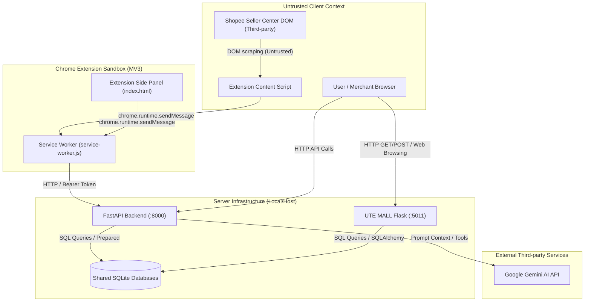

# System Architecture & Trust Boundaries (Cloudflare Security Audit Phase 1)

## 1. Overview
ShipCode SellerPilot is an omnichannel e-commerce management and assistant platform designed for Vietnamese marketplace sellers (Shopee, TikTok Shop, and local mock marketplace UTE MALL).

## 2. Core Components
| Component | Runtime / Framework | Default Port | Role & Boundaries |
| :--- | :--- | :--- | :--- |
| **Backend API** | Python 3.11 / FastAPI / SQLAlchemy / SQLite | `8000` | Central API Gateway, auth tokens, chat sessions, catalog operations, sync broker. |
| **UTE MALL** | Python 3.11 / Flask / Jinja2 / SQLite | `5011` | Standalone local marketplace demo, seller portal, checkout simulator. |
| **Frontend Web/App** | Expo SDK 58 / React Native Web | `8081` (or `5173`) | Merchant dashboard, conversational assistant UI, mobile client. |
| **Chrome Extension** | Manifest V3 / ES Modules | Chrome Runtime | Shopee seller center scraper, side panel UI, autofill assist. |
| **External AI** | Google Gemini API (gemini-2.5/3.5) / Ollama | External HTTPS | LLM reasoning, strategic pricing advice, product draft generation. |

## 3. Trust Boundaries

## 4. Attack Surfaces & Input Entry Points
1. **HTTP Endpoints (FastAPI & Flask)**:
   - Auth endpoints (`/api/v1/auth/login`, `/login`)
   - Chat endpoint (`/api/v1/chat`, `/api/v1/chat/requests`)
   - Catalog management (`/api/v1/products`, `/seller/products`)
   - Order & media static uploads (`/store-static`, `/uploads/sellerpilot`)
2. **Extension RPC & Message Passing**:
   - `chrome.runtime.onMessage` in `service-worker.js`
   - Content scripts injected on `https://banhang.shopee.vn/*`
3. **AI Prompt & Tool Execution Surface**:
   - User chat inputs submitted to `GeminiClient`
   - Tool calling payloads generated by Gemini executed on catalog state
